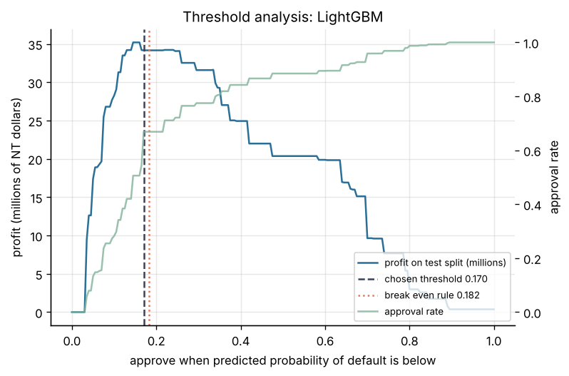

# Project 1: Credit default risk

Predict which credit card clients will default next month, and set the approval threshold that gives the highest profit under a stated cost matrix.



## Headline result

On a held out test split of 6,000 clients, LightGBM reaches **ROC AUC 0.782** against **0.747** for the logistic regression baseline. At the chosen threshold (approve when the calibrated probability of default is below 0.170) it approves 66.9 percent of clients, the default rate among approved clients falls to 11.4 percent from 22.1 percent overall, and the test profit is **34.2 million NT dollars**, against 29.7 million for the baseline and 0.4 million for approving every client. The profit figures depend on the cost assumptions below.

| Model | CV ROC AUC | Test ROC AUC | Test PR AUC | Test Brier (calibrated) | Threshold | Test approval rate | Test profit (NT dollars) |
| --- | ---: | ---: | ---: | ---: | ---: | ---: | ---: |
| Logistic regression (baseline) | 0.7607 | 0.7468 | 0.4913 | 0.1425 | 0.165 | 0.6255 | 29,708,044 |
| **LightGBM (selected)** | 0.7872 | 0.7821 | 0.5460 | 0.1346 | 0.170 | 0.6687 | 34,170,500 |
| XGBoost | 0.7880 | 0.7822 | 0.5502 | 0.1340 | 0.180 | 0.6502 | 33,588,500 |

LightGBM and XGBoost perform at the same level on the test split. LightGBM was selected before the test split was scored, because its out of fold profit on the training split was slightly higher (151.34 against 151.28 million NT dollars). Full tables: [`reports/model_comparison.md`](reports/model_comparison.md), [`reports/results.json`](reports/results.json). Model card: [`MODEL_CARD.md`](MODEL_CARD.md).

## Dataset and license

[Default of Credit Card Clients](https://archive.ics.uci.edu/dataset/350/default+of+credit+card+clients), UCI Machine Learning Repository. 30,000 credit card clients in Taiwan, with monthly payment records from April to September 2005, with 23 features and a binary target: default payment in the following month (22.1 percent positive).

**License: Creative Commons Attribution 4.0 International (CC BY 4.0).**
Citation: Yeh, I. (2009). Default of Credit Card Clients [Dataset]. UCI Machine Learning Repository. https://doi.org/10.24432/C55S3H

The raw data is not committed to this repository. `make data` downloads it from UCI.

## Approach

1. **Load and check** (`data.py`): read the spreadsheet, find its header row, check that all 25 expected columns are present, that client ids are unique and that the target is binary.
2. **Features in SQL** (`sql/features.sql`, run by DuckDB): from six months of repayment status, bills and payments: maximum delay, number of months in delay, credit utilization (latest, mean, maximum), bill trend, ratio of amount paid to amount billed, and number of months with a bill but no payment. Sex, education and marital status are categorical.
3. **Models** (`modeling.py`): logistic regression as the baseline; LightGBM and XGBoost with stratified five fold cross validation and early stopping. The final tree count is the mean best iteration across folds.
4. **Calibration**: isotonic regression fitted on the out of fold predictions, so the calibrator never sees a prediction on a row the model trained on. The boosted models were already close to calibrated; isotonic calibration changed the Brier score by less than 0.001 ([figure](reports/figures/calibration.png)).
5. **Threshold** (`threshold.py`): approve when the calibrated probability of default is below the threshold. The threshold is chosen on out of fold predictions of the training split only. The chosen value (0.170) is close to the break even rule `margin / (margin + loss_given_default)` = 0.182.
6. **Selection**: the model with the highest out of fold profit. The held out test split (20 percent, stratified) is scored once, for this report.
7. **Explanations** (`evaluate.py`): exact TreeSHAP values from LightGBM ([figure](reports/figures/explanations.png)). The latest repayment status (`PAY_0`) and the delay features carry most of the signal, followed by payment amounts and the credit limit.
8. **Fairness check** (`fairness.py`): metrics per age band at the chosen threshold ([table](reports/fairness_age.md)). Approval rates range from 60.5 percent (60 and over, 76 clients) to 70.0 percent (30 to 39); ROC AUC ranges from 0.745 to 0.789.
9. **Tracking**: every model run is logged to a local MLflow store under `artifacts/` (`mlflow ui --backend-store-uri sqlite:///artifacts/mlflow.db`).
10. **Serving** (`api.py`, `Dockerfile`): a FastAPI service that returns the probability of default and the decision.

### Cost assumptions

The cost matrix is an assumption, not a value from the data. The credit limit (`LIMIT_BAL`) serves as the exposure.

| Parameter | Value | Meaning |
| --- | ---: | --- |
| `loss_given_default` | 0.45 | share of the credit limit lost when a client defaults |
| `margin` | 0.10 | share of the credit limit earned when a client repays |

Both can be changed: `python -m loan_default.train --lgd 0.6 --margin 0.08`.

## Reproduce

From this folder, with Python 3.11 or later:

```bash
make install            # this project and the shared common package
make all                # data, features, train, evaluate (under one minute in the build environment)
make smoke              # the same pipeline on a synthetic table, no download
```

`make sample SAMPLE=0.25` runs the same pipeline on a seeded share of the real clients, stratified by default. Its data and outputs stay under `artifacts/sample/`, and `sample.json` there records the share, the seed and the counts. The option was added after the full run and has not been run; the committed results come from the full data. The data step takes the same option as `--sample` and `--sample-seed`.

`make smoke` writes everything under `artifacts/smoke/`. Its numbers come from random synthetic data and say nothing about credit risk.

### Scoring API

```bash
make api                # after make train; docs at http://localhost:8000/docs
curl -X POST localhost:8000/score -H 'Content-Type: application/json' -d @artifacts/example_request.json
```

Docker: `make docker`, then `docker run -p 8000:8000 loan-default-api`.

## Layout

```
src/loan_default/   config, data, features, sql/, modeling, threshold, fairness, train, evaluate, api, synthetic
tests/              unit tests and an end to end test on a synthetic table
reports/            comparison tables, fairness table, figures
```

## Cost

No paid service used: 0 CAD.
