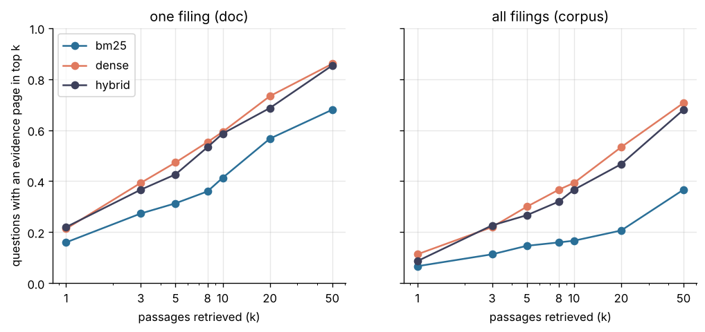

# Project 2: Question answering over company filings

Answer analyst questions about annual and quarterly reports with cited passages, and measure how often the answers are correct and supported by what they cite.



## Headline result

**Retrieval.** Searching inside the filing a question names, dense MiniLM retrieval places an evidence page among the top 8 passages for **55.3 percent** of the 150 questions, against **36.0 percent** for BM25. Hybrid fusion (53.3 percent) does not beat dense retrieval alone here. Searching all 84 filings, the figures fall to 36.7 and 16.0 percent; dense retrieval still finds the right filing among the top 8 passages for 90.7 percent of questions.

| Setting | Retriever | Recall@1 | Recall@5 | Recall@8 | Recall@20 | Recall@50 | MRR |
| --- | --- | ---: | ---: | ---: | ---: | ---: | ---: |
| one filing | BM25 (baseline) | 0.160 | 0.313 | 0.360 | 0.567 | 0.680 | 0.246 |
| one filing | **dense** | 0.213 | **0.473** | **0.553** | **0.733** | **0.860** | **0.340** |
| one filing | hybrid | 0.220 | 0.427 | 0.533 | 0.687 | 0.853 | 0.333 |
| all filings | BM25 (baseline) | 0.067 | 0.147 | 0.160 | 0.207 | 0.367 | 0.107 |
| all filings | dense | 0.113 | 0.300 | 0.367 | 0.533 | 0.707 | 0.204 |
| all filings | hybrid | 0.087 | 0.267 | 0.320 | 0.467 | 0.680 | 0.187 |

Recall@k: share of questions with a passage from an evidence page among the top k. Full table: [`reports/retrieval_results.md`](reports/retrieval_results.md).

**Answers.** Pending. The Claude API runs and the local open weights comparison are not run yet; their cost estimate is under Cost. The free extractive floor (first retrieved passage as the answer) is in [`reports/qa_results.md`](reports/qa_results.md). Its figure match (26 percent with dense retrieval, 42 percent with the evidence pages) overstates what it achieves: a whole passage contains many numbers, and the measure only asks whether the reference figure appears among them. For model answers, which are short, the judge is the primary measure.

**Section classification.** On 1,184 pages from 8 companies held out from training, TF-IDF with logistic regression reaches macro F1 **0.625** (accuracy 0.780), against 0.102 for the majority class and 0.598 for frozen MiniLM embeddings with logistic regression. Market risk (38 pages in all) and the "other" group are the weak classes. Details: [`reports/section_classification.md`](reports/section_classification.md), [confusion matrix](reports/figures/section_confusion.png).

## Dataset and license

[FinanceBench](https://github.com/patronus-ai/financebench) open sample (Patronus AI): 150 questions about 32 public companies, each with a reference answer written by an analyst and the evidence pages it rests on, plus the 84 filings the questions cite (10-K, 10-Q, 8-K and earnings reports, as PDF).

**License: Creative Commons Attribution Non Commercial 4.0 (CC BY-NC 4.0)**, as stated on the dataset's Hugging Face page. This project uses it for non commercial evaluation only. The filings themselves are public documents filed with the US Securities and Exchange Commission.
Citation: Islam, P., Kannappan, A., Kiela, D., Qian, R., Scherrer, N., and Vidgen, B. (2023). FinanceBench: A New Benchmark for Financial Question Answering. arXiv:2311.11944.

`make data` downloads the files from a fixed commit of the FinanceBench repository. No data is committed here. Two inconsistencies in the source are handled in `data.py`: the evidence records name their document in a field called `doc_name` (the source README says `evidence_doc_name`), and one filing (`FOOTLOCKER_2023_annualreport`) is listed twice with the same link; it is kept once.

The plan named SEC EDGAR as the source of filings. EDGAR is not reachable from the build environment, so the corpus is the set of filings that FinanceBench ships, which also keeps the evaluation set and the corpus aligned.

## Approach

1. **Parse** (`parse.py`): text of every PDF page with pypdf (12,013 pages; 0.5 percent without extractable text). Pages split into passages of 180 words with a 40 word overlap (46,701 passages). A passage never crosses a page, so every citation points to one page.
2. **Index** (`retrieval.py`):
   * BM25 over words, implemented on a sparse matrix;
   * dense vectors from all-MiniLM-L6-v2 (ONNX build that Chroma downloads) in a persistent Chroma collection;
   * hybrid: reciprocal rank fusion of the two lists.

   A cross encoder reranker was planned; its model files come from Hugging Face, which the build environment cannot reach, so the step is left out.

   Each passage is indexed with a short header (company, period, form), because filing pages seldom repeat the company name.
3. **Retrieval evaluation** (`evaluate_retrieval.py`): a passage is relevant when it lies on one of the question's evidence pages. Two settings: **doc**, search inside the filing the question names (an analyst who has the report open), and **corpus**, search all 84 filings. The top 8 passages of each question are stored as the context for answering. An **oracle** context (all passages of the evidence pages) gives the upper bound for the answer step.
4. **Answer** (`generation.py`): the model receives numbered passages and returns JSON with the answer, the numbers of the passages it relies on, and whether the passages suffice. Generators: Claude models through the API; an open weights model through a local Ollama; and an extractive floor that returns the first passage.
5. **Score** (`scoring.py`):
   * figure match (free): for the 50 questions whose reference answer is one figure, whether the answer states it, allowing rounding and a change of scale;
   * evidence citation (free): whether a cited passage lies on an evidence page;
   * judge (paid): a Claude model grades each answer against the reference (correct, incorrect, declined) and checks that the cited passages support every figure and claim in it.
6. **Report** (`report.py`): accuracy, support, tokens, cost and latency per run.
7. **Section classification** (`sections.py`): a classifier that assigns a 10-K page to its section (business, risk factors, management discussion, market risk, financial statements, other), for routing questions to the right part of a filing. Labels come from the filings' own "Item" headings; only pages without a heading enter training and test, and test companies are held out. Compared: majority class, TF-IDF with logistic regression, and frozen MiniLM embeddings with logistic regression. Full fine tuning of a transformer was planned but needs model files from Hugging Face, which the build environment cannot reach.

## Reproduce

From this folder, with Python 3.11 or later:

```bash
make install                 # this project, the shared common package, the demo
make all                     # data, parse, index, retrieval evaluation, sections, extractive baseline, report
make smoke                   # the free pipeline on a synthetic corpus: no download, no paid call
```

`make sample SAMPLE=0.25` runs the same pipeline on a seeded share of the real filings, each with all the questions on it. Its data and outputs stay under `artifacts/sample/`, and `sample.json` there records the share, the seed and the counts. The option was added after the full run and was first run on Colab on 2026-10-26; those outputs are not committed, and the committed results come from the full data. The data step takes the same option as `--sample` and `--sample-seed`.

`make index` builds the dense index in about 90 minutes on four CPU cores. Paid and local model steps are separate:

```bash
export ANTHROPIC_API_KEY=...            # read only from the environment; never stored
make estimate                           # cost estimate, no call
make answer-claude MAX_USD=8            # stops before spending 8 USD
ollama pull qwen2.5:7b && make answer-ollama
make grade MAX_USD=2 && make report     # judge every run, then rebuild the tables
make demo                               # Gradio app on http://localhost:7860
```

The Claude client always calls `https://api.anthropic.com`, whatever `ANTHROPIC_BASE_URL` says, so a base URL set for another tool never receives this key.

## Layout

```
src/filings_qa/   config, data, parse, retrieval, evaluate_retrieval, generation, scoring, report, sections, demo, synthetic
tests/            unit tests and an end to end test on the synthetic corpus
reports/          retrieval, answer and section tables; figures
```

## Cost

So far: 0 USD. Data, parsing, indexes, retrieval evaluation, section classification and the extractive baseline use no paid service.

Estimate for the pending Claude runs (150 questions, 8 passages each, about 2,400 input tokens per question; 1,500 output tokens per answer including thinking is an assumption): about 6 USD per run with Claude Opus 5.5, 3 USD with Claude Sonnet 5.5, 0.15 USD with Claude Haiku 5.5; grading one run costs about 0.8 USD with Sonnet 5.5 as judge. Real figures will replace these.
