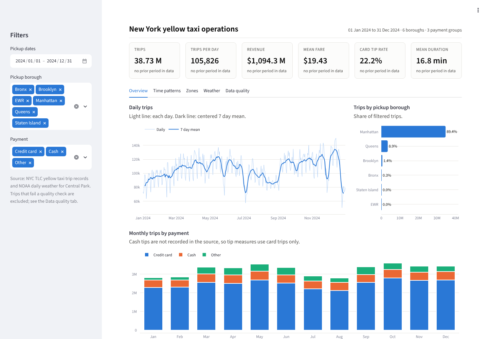
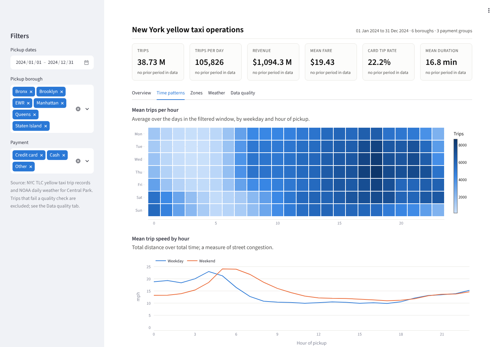
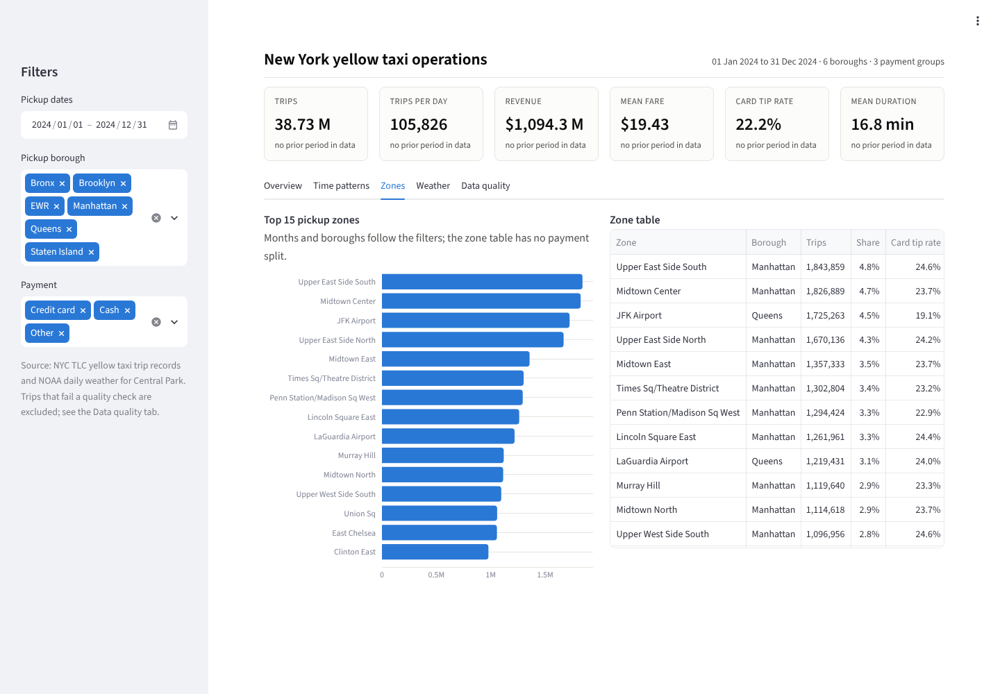
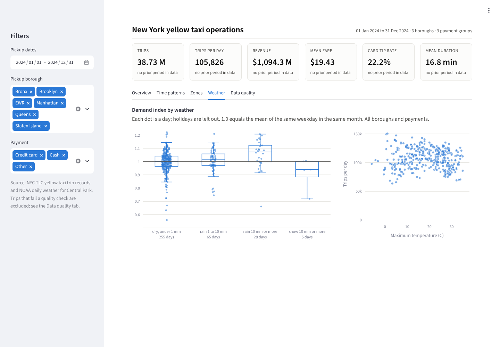
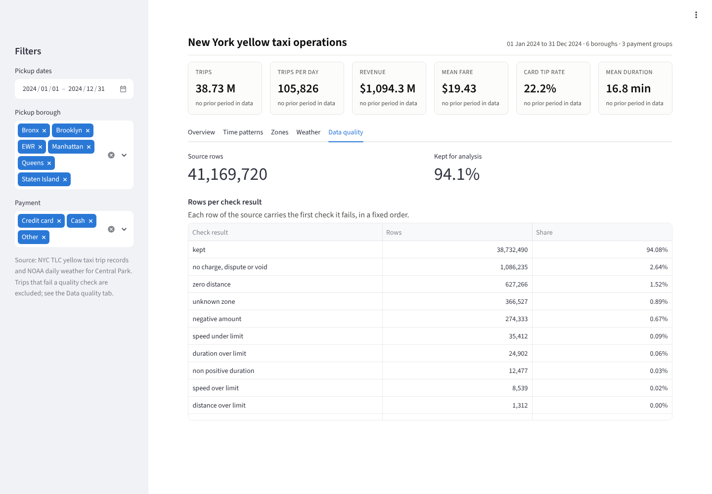

# Project 3: New York taxi demand

Describe how yellow taxi demand, fares and tips vary by time, zone and weather in New York City in 2024, and present the result in a dashboard for an operations manager.



## Headline result

38.7 million usable trips (94.1 percent of 41.2 million source records), 105,826 per day on average. Five findings, each backed by one SQL query; the two page report is [`reports/findings.md`](reports/findings.md):

1. **Demand follows the working week and the evening.** The busiest hour, Thursday 18:00, averages 8,666 trips, about 50 times the quietest (Tuesday 03:00). July and August run about 22 percent below October.
2. **Daytime streets are as slow as the evening rush.** Weekday speed falls from 23.0 miles per hour at 04:00 to between 9.9 and 10.8 for every hour from 08:00 to 18:00.
3. **Airport trips are 9.8 percent of trips and 27.1 percent of revenue.**
4. **Tip differences between boroughs come from trips without any tip.** The card tip rate is 23.3 percent in Manhattan and 1.1 percent in the Bronx, but the median tip when there is one is 22.6 to 26.6 percent everywhere; 95.0 percent of Bronx card trips record no tip, against 4.4 percent in Manhattan.
5. **Weather moves demand less than the day of the week does.** Days with 10 mm of rain or more are 5.2 percent busier than comparable days (plus or minus 4.1 points, 28 days); the snow effect is not distinguishable from zero with five snow days.

## Dashboard

A mock up in the layout of a BI report, built with Streamlit and Plotly (no BI tool license needed). Filters for dates, pickup borough and payment group; six headline measures with the change against the preceding period of equal length; five tabs.

| Time patterns | Zones |
| --- | --- |
|  |  |
| **Weather** | **Data quality** |
|  |  |

## Dataset and license

* **Trips:** [NYC Taxi and Limousine Commission trip record data](https://www.nyc.gov/site/tlc/about/tlc-trip-record-data.page), yellow taxi records for January to December 2024 (12 Parquet files, 41,169,720 rows), and the taxi zone lookup table (265 zones). Terms: the [NYC.gov terms of use](https://www.nyc.gov/main/terms-of-use) state that materials on NYC.gov are provided "as is", without warranty of accuracy or completeness. No explicit license for the trip data was found; the data is not redistributed here and is downloaded from the TLC by `make data`.
* **Weather:** [NOAA NCEI daily summaries (GHCN Daily)](https://www.ncei.noaa.gov/access/services/data/v1?dataset=daily-summaries&stations=USW00094728&startDate=2024-01-01&endDate=2024-12-31&dataTypes=PRCP,SNOW,TMAX,TMIN&units=metric&format=csv) for New York Central Park, station USW00094728, 366 days: precipitation, snowfall, maximum and minimum temperature, metric units. No explicit license for these weather records was confirmed; the data is not redistributed here and is downloaded from NOAA by `make data`.

The repository holds only code and results derived from the data: aggregated tables, figures and findings. The raw data is not committed to this repository. `make data` downloads it. Where the download hosts are not reachable, files downloaded by hand can be placed with `make ingest SOURCES=<folder>`, which identifies each file by its content; this is how the run reported here received its data.

## Approach

1. **Load and check** (`data.py`, `ingest.py`): download each monthly file and check that every required column is present before any query runs.
2. **Warehouse in SQL** (`sql/01_*.sql` to `sql/06_*.sql`, run by DuckDB, 19 seconds for the full year on 4 CPU cores): a typed trip table in which each trip carries the first quality check it fails; a quality audit; and summary tables: hourly facts by pickup borough and payment group, pickup zone by month, and one row per day joined with the weather and a holiday flag.
3. **Query library** (`sql/analysis/a01_*.sql` to `a11_*.sql`): monthly trend, demand by weekday and hour, speed by hour, demand index by weather class, zone concentration, card tip rate by borough and hour, airport trips, zone volume cohorts, payment mix, quality audit, zero tip share by borough. `make report` runs all eleven and writes [`reports/query_results.md`](reports/query_results.md), [`reports/key_numbers.json`](reports/key_numbers.json) and the figures.
4. **Weather effect:** each day's trips are divided by the mean of the non holiday days with the same weekday in the same month (the demand index), so that weekly and seasonal patterns do not mask the weather. Federal holidays, 24 December and 31 December are left out of the comparison.
5. **Notebook** ([`notebooks/analysis.ipynb`](notebooks/analysis.ipynb)): generated from the query library and executed by `make notebook`, so its cells always match the SQL files.
6. **Dashboard** (`dashboard/app.py`): reads only the summary tables (3 MB), so it starts in seconds. Every ratio is a ratio of sums, so it stays exact under any filter.
7. **Scheduling** (`dags/taxi_refresh.py`): an Airflow DAG that runs daily, fetches any newly published month, rebuilds the warehouse and refreshes the report tables. It parses without errors under Airflow 3.3.2; it has not been run against a live Airflow scheduler.

### Data quality

| Check result | Rows | Share |
| --- | ---: | ---: |
| kept | 38,732,490 | 94.08% |
| no charge, dispute or void | 1,086,235 | 2.64% |
| zero distance | 627,266 | 1.52% |
| unknown zone | 366,527 | 0.89% |
| negative amount | 274,333 | 0.67% |
| all other checks | 82,869 | 0.20% |

Each row carries the first check it fails, in a fixed order, so the shares add to 100 percent.

### Analysis choices

* Tip measures use credit card trips only, because the source does not record cash tips.
* 9.5 percent of usable trips have payment type 0, with no passenger count and no rate code. They are kept and shown as "Other" payment.
* The limits for a plausible trip (180 minutes, 100 miles, 500 US dollars, 0.5 to 80 miles per hour) are analysis choices, set in `config.py`, not TLC rules.

## Reproduce

From this folder, with Python 3.11 or later:

```bash
make install            # this project and the shared common package
make all                # data, build, report, notebook (about 650 MB download)
make dashboard          # http://localhost:8501
```

`make screenshots` refreshes the dashboard images (needs Playwright Chromium). `make smoke` runs the warehouse and the report on synthetic files under `artifacts/smoke/`; its numbers come from random data and say nothing about New York taxis.

`make sample SAMPLE=0.05` runs the same pipeline on a seeded share of the real trips of every month, selected at the warehouse build. Its data and outputs stay under `artifacts/sample/`, and `sample.json` there records the share, the seed and the counts. The option was added after the full run and has not been run; the committed results come from the full data. The warehouse step takes the same option as `--sample` and `--sample-seed`.

## Layout

```
src/taxi_demand/    config, data, ingest, warehouse, sql/, sql/analysis/, report, notebook, dashboard_data, screenshots, synthetic
dashboard/          Streamlit app
dags/               Airflow DAG
notebooks/          generated analysis notebook
tests/              unit tests, warehouse tests on synthetic files, dashboard render test
reports/            findings, query results, key numbers, figures
```

## Cost

No paid service used: 0 CAD.
