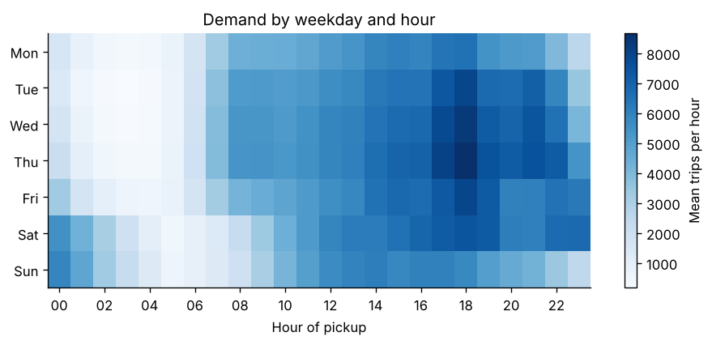
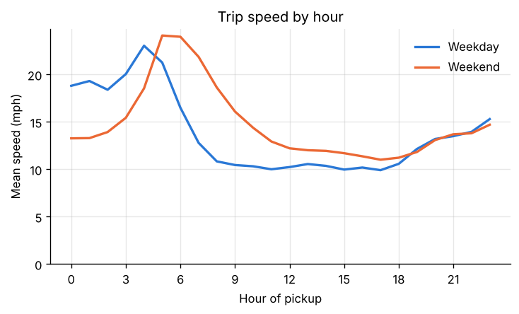
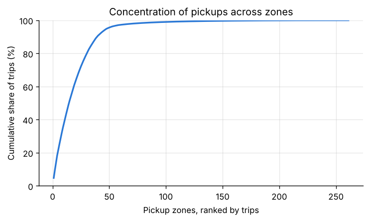
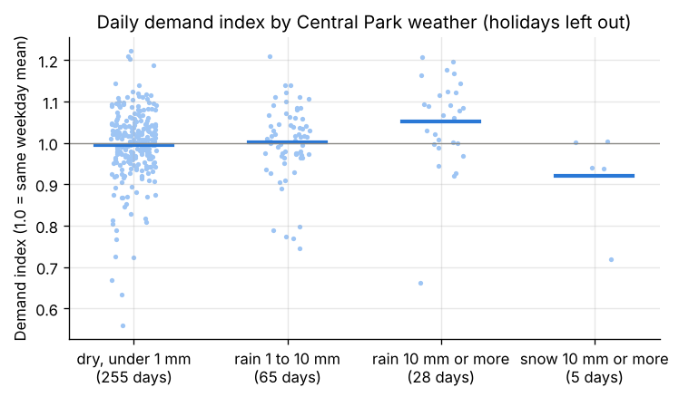

# Findings: New York yellow taxi trips, 2024

**Audience:** an operations manager responsible for fleet supply, airport queues and driver pay.
**Data:** 41,169,720 TLC yellow taxi trip records for 2024, of which 38,732,490 (94.1 percent) pass the quality checks; NOAA daily weather for Central Park. All figures below use the usable trips only. Every number comes from one query in `src/taxi_demand/sql/analysis/`; the full outputs are in [`query_results.md`](query_results.md) and [`key_numbers.json`](key_numbers.json).

## Data quality first

Of the source rows, 2.6 percent are no charge, dispute or voided trips, 1.5 percent have zero distance, 0.9 percent start or end in an unknown zone, and 0.7 percent carry a negative amount. All other checks together remove less than 0.2 percent. A further 9.5 percent of usable trips have payment type 0, with no passenger count and no rate code; they are kept and shown as "Other" payment, because their fares and times are plausible. The audit is on the dashboard's Data quality tab.

## 1. Demand follows the working week and the evening

An average of 105,826 trips per day. The busiest hour of the week is Thursday 18:00 with 8,666 trips on average; the quietest is Tuesday 03:00 with 175, a ratio of about 50 to 1. Thursday is the busiest day (116,465 trips on an average Thursday) and Monday the quietest (90,662). Weekend nights differ from weekday nights: between 00:00 and 01:00, Saturday and Sunday see about 5,500 to 5,900 trips against 1,350 to 2,100 from Monday to Thursday.

Across the year, July and August are the quietest months (93,348 and 89,861 trips per day), together with January (90,510). October is the busiest (115,529). The summer drop is about 22 percent against October.

*For operations:* driver supply should follow the weekday evening peak and the weekend night peak, which fall at different hours; the summer dip is the natural time for fleet maintenance.

## 2. Daytime streets are as slow as the evening rush

On weekdays the mean trip speed (total distance over total time) falls from 23.0 miles per hour at 04:00 to between 9.9 and 10.8 miles per hour for every hour from 08:00 to 18:00, with the lowest value at 17:00. There is no separate morning or evening dip: the whole working day runs at the same low speed. Weekend speeds peak later, at 24 miles per hour around 05:00 to 06:00, and stay above weekday speeds until the evening.

*For operations:* trip durations and fares quoted for the working day should assume about 10 miles per hour, not a rush hour figure.

## 3. Airport trips are one tenth of the trips and more than one quarter of the revenue

Trips that start or end at JFK, LaGuardia or Newark make up 9.8 percent of usable trips and 27.1 percent of total revenue. Their mean total is 77.82 US dollars against 22.84 for all other trips, with a mean distance of 13.4 miles against 2.3. JFK and LaGuardia are the third and ninth busiest pickup zones of 261. Pickups are otherwise concentrated in Manhattan (89.4 percent of trips); the ten busiest zones hold 37.8 percent of all pickups.

*For operations:* airport queue management has a revenue weight about three times its trip count.

## 4. Tip differences between boroughs come from trips without any tip

On credit card trips (cash tips are not recorded in the source), the tip equals 22.2 percent of the fare overall. By pickup borough it is 23.3 percent in Manhattan, 20.4 percent in Queens, 5.8 percent in Brooklyn and 1.1 percent in the Bronx. The size of the tip, when there is one, barely differs: the median is 22.6 to 26.6 percent of the fare in these four boroughs. What differs is the share of card trips with no tip at all: 4.4 percent in Manhattan, 8.2 percent in Queens, 70.0 percent in Brooklyn and 95.0 percent in the Bronx. The data does not show why; the large zero tip shares in Brooklyn and the Bronx (323,380 card trips together) merit a check of how those trips are booked and recorded before any conclusion about passengers.

## 5. Weather moves demand less than the day of the week does

Each day's trips were divided by the mean of the same weekday in the same month (holidays left out, 353 days remain). On days with 10 mm of rain or more, demand was 5.2 percent above that mean (28 days; 95 percent interval plus or minus 4.1 points). Light rain (1 to 10 mm, 65 days) and dry days (255 days) show no difference. The five days with 10 mm of snow or more averaged 8 percent below, but the interval (plus or minus 10 points) includes no effect. For comparison, the daily index varies by about 8.5 percent on dry days alone, so weather explains little of the day to day variation in this year.

*For operations:* heavy rain justifies a modest increase in supply; snow needs more years of data before a rule can be set.

## Limits

* One year of yellow taxi trips only. Green taxis and app based ride hail trips, which the TLC publishes in separate files, are not included, so these are statements about yellow taxis, not about all street demand.
* Pickup zones and boroughs come from the TLC zone of the pickup location; trips are not assigned to drivers or vehicles.
* The weather comes from one station in Central Park and is daily; a storm in the evening counts the same as one in the morning.
* The quality limits (180 minutes, 100 miles, 500 US dollars, 0.5 to 80 miles per hour) are analysis choices.
