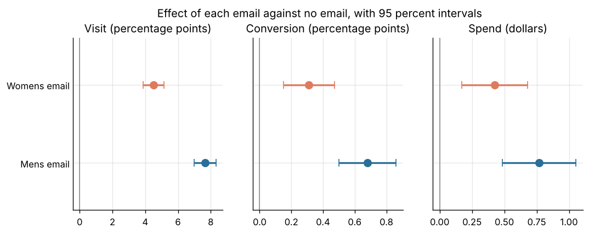
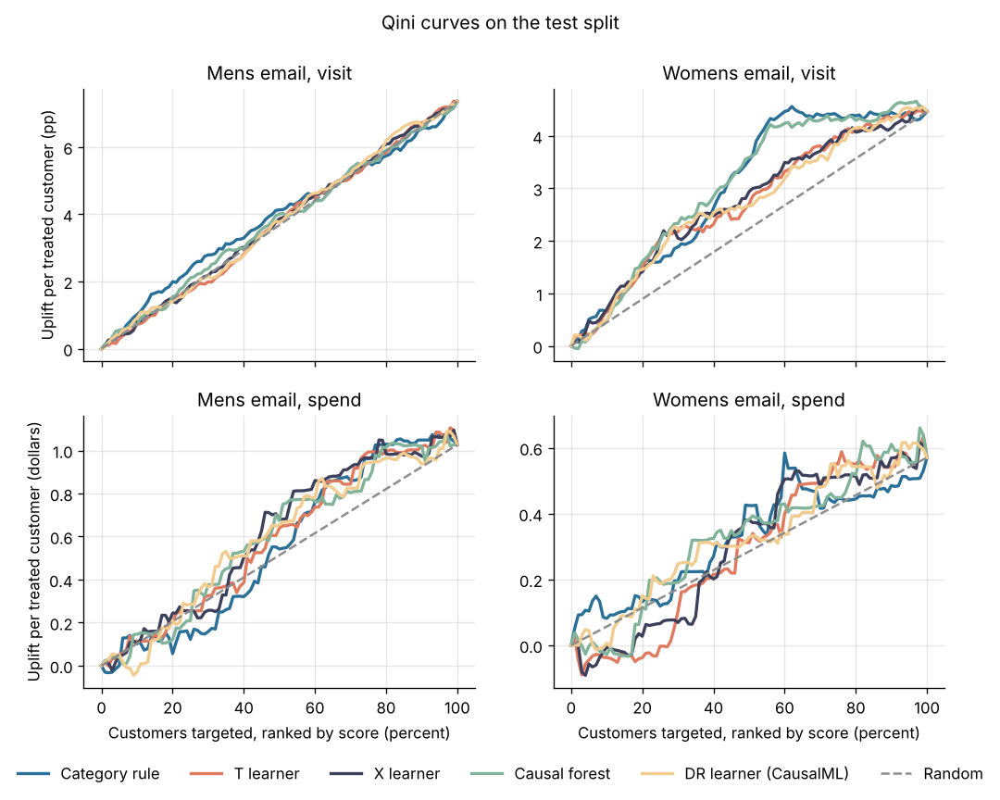

# Project 4: Email campaign uplift

Decide whether an email campaign increased spending, and which customers should receive the next one.



## Headline result

Both emails raised two week spend against no email, with every effect significant after Holm correction:

| Arm | Visit | Conversion | Spend per customer |
| --- | ---: | ---: | ---: |
| Mens email | +7.66 pp (7.00 to 8.32) | +0.68 pp (0.50 to 0.86) | **+$0.77** ($0.49 to $1.05) |
| Womens email | +4.52 pp (3.89 to 5.16) | +0.31 pp (0.15 to 0.47) | **+$0.42** ($0.17 to $0.68) |

Intervals are 95 percent; pp means percentage points. The control arm visited at 10.6 percent and spent $0.65 per customer.

**Recommendation: send the mens email to every customer.** It earns **$0.396** profit per customer on the test split, against $0.188 with no email, under the assumed economics below. Four uplift models (T learner, X learner, causal forest, CausalML DR learner) do not beat it: no model ranks customers by incremental spend better than chance, and every model policy earns less than mailing everyone (differences inside the bootstrap intervals). The models do find who responds in **visits**: for the womens email, the causal forest reaches a Qini coefficient of 0.82 points (0.53 to 1.19), against a random band of ±0.32. A rule that sends the womens email to womens buyers first does as well (0.79).

The full readout is written as an internal memo: [`reports/experiment_readout.md`](reports/experiment_readout.md).

| Policy (test split, 19,200 customers) | Profit per customer (95% CI) | Share mailed |
| --- | ---: | ---: |
| No email | 0.188 (0.119 to 0.261) | 0% |
| **Mens email to all (selected on validation)** | **0.396** (0.249 to 0.543) | 100% |
| Womens email to all | 0.259 (0.146 to 0.385) | 100% |
| Category rule (mens email to mens buyers, womens email to the rest) | 0.339 (0.208 to 0.484) | 100% |
| X learner policy | 0.367 (0.217 to 0.513) | 70% |
| DR learner (CausalML) policy | 0.356 (0.230 to 0.500) | 72% |
| Causal forest policy | 0.344 (0.221 to 0.480) | 74% |
| T learner policy | 0.288 (0.162 to 0.396) | 70% |

Full tables: [`ab_results.md`](reports/ab_results.md), [`uplift_comparison.md`](reports/uplift_comparison.md), [`policy.md`](reports/policy.md), [`observational.md`](reports/observational.md), [`results.json`](reports/results.json).

## Dataset and license

[Kevin Hillstrom: MineThatData E-Mail Analytics and Data Mining Challenge](https://blog.minethatdata.com/2008/03/minethatdata-e-mail-analytics-and-data.html) (March 2008). 64,000 customers who last purchased within twelve months, randomly split into three equal groups: a mens merchandise email, a womens merchandise email, and no email. Outcomes are visits, conversions and spend in the two weeks after the send. Pre treatment features: months since last purchase, past year spend, mens and womens purchase flags, zip code type, new customer flag and purchase channel.

**License: no license or terms of use are stated** on the original blog post or on the scikit-uplift page that documents the copy used here. This repository therefore claims no license for the data and does not redistribute it.

The original host does not resolve from the build environment. `make data` downloads the copy that scikit-uplift's `fetch_hillstrom` uses (`hillstorm1.s3.us-east-2.amazonaws.com`, 0.4 MB gzip CSV) and checks its SHA256 checksum, its 64,000 rows and every column and category. A local copy of the original CSV can be used instead: `python -m email_uplift.data --source <file>`.

The Criteo uplift dataset, planned as a scale extension, is left out: its download host does not respond from the build environment.

## Approach

1. **Load and check** (`data.py`): checksum, schema, categories, value ranges, and that no spend is recorded without a conversion.
2. **Randomization checks** (`experiment.py`): a chi square sample ratio test (p = 0.90 against the equal split) and standardized mean differences of every pre treatment feature (largest 0.014; adequate balance is below 0.1).
3. **Effects**: difference in means per arm and outcome, Welch standard errors, Holm correction over the six tests.
4. **Power**: minimum detectable effect at 80 percent power with the arm sizes of this test ($0.31 for spend), and the sample size a new test would need to detect each observed effect.
5. **Variance reduction**: CUPED with past year spend as the pre period covariate, and regression adjustment on all pre treatment features (Lin 2013, HC2 errors). Past year spend barely predicts two week spend (correlation 0.022), so CUPED removes less than 0.1 percent of the spend variance; regression adjustment removes 2.9 percent of the visit variance. Neither changes a conclusion. This is a property of the data, not of the method: CUPED needs a covariate that predicts the outcome.
6. **Uplift models** (`uplift.py`, `train.py`): T learner, X learner and causal forest from EconML, and the doubly robust learner from CausalML, all on LightGBM, each fitted once on visits and once on spend with both email arms as treatments. The randomization fixes the propensity, so learners that need one get the design shares instead of a fitted model. Split: fit 52.5 percent, validation 17.5 percent, test 30 percent, stratified by arm.
7. **Targeting policy**: per customer, the email with the highest predicted incremental profit, or no email when no email covers its cost. The policy is chosen on the validation split among the model policies and four simple ones (no email, mens email to all, womens email to all, category rule).
8. **Evaluation** (`targeting.py`, `evaluate.py`): Qini curves and coefficients per arm, and policy values estimated from the randomized arms (Horvitz Thompson), all with bootstrap intervals on the test split, which is scored once. Random rankings give the noise floor that a Qini coefficient must clear. A cost sensitivity table shows that at no email cost from $0.00 to $0.50 does the model policy beat the best simple policy.
9. **Observational analysis** (`observational.py`): the mens email and control arms are resampled as if a marketer had mailed recent, high value web customers more often, so who got the email depends on who would visit anyway. DoWhy then estimates the effect with three estimators under two sets of assumptions, averaged over 20 draws:

   | Visit effect, pp | Estimate | Bias |
   | --- | ---: | ---: |
   | Experiment (benchmark) | 7.66 | 0 |
   | Naive difference | 12.23 | +4.57 |
   | Regression, past spend left out | 9.70 | +2.04 |
   | Propensity weighting, past spend left out | 9.72 | +2.06 |
   | Regression, full adjustment | 7.56 | -0.10 |
   | Propensity weighting, full adjustment | 7.65 | -0.01 |

   Leaving one confounder out keeps half of the bias. DoWhy's placebo, random common cause and data subset refuters pass for the incomplete adjustment as well as the full one, so they cannot reveal a missing confounder ([figure](reports/figures/observational.png)).
10. **Tracking**: every uplift model run is logged to a local MLflow store under `artifacts/` (`mlflow ui --backend-store-uri sqlite:///artifacts/mlflow.db`).



### Economic assumptions

The economics are assumptions, not values from the data.

| Parameter | Value | Meaning |
| --- | ---: | --- |
| `margin` | 0.30 | profit per incremental dollar of spend |
| `cost_per_email` | 0.10 | dollars per email sent (delivery, creative, risk of an unsubscribe) |

At a 30 percent margin, mailing everyone beats mailing no one while an email costs less than $0.31 ([cost sensitivity](reports/figures/cost_sensitivity.png)). Both values can be changed: `python -m email_uplift.train --margin 0.4 --cost-per-email 0.05`, then `make evaluate report`.

## Reproduce

From this folder, with Python 3.11 or later:

```bash
make install            # this project, the shared common package and CausalML
make all                # data, experiment, train, evaluate, observational, report (110 seconds on 4 CPU cores)
make smoke              # the same pipeline on synthetic customers, no download
```

`make sample SAMPLE=0.25` runs the same pipeline on a seeded share of the real customers, stratified by arm. Its data and outputs stay under `artifacts/sample/`, and `sample.json` there records the share, the seed and the counts. The option was added after the full run and was first run on Colab on 2026-10-26; those outputs are not committed, and the committed results come from the full data. The data step takes the same option as `--sample` and `--sample-seed`.

CausalML may compile from source; without it (`pip install -e ../../common -e ".[dev]"`), the pipeline skips the DR learner and runs the other three models. `make smoke` writes everything under `artifacts/smoke/`. Its numbers come from synthetic data and say nothing about the campaign.

## Layout

```
src/email_uplift/   config, data, experiment, uplift, targeting, train, evaluate, observational, report, synthetic
tests/              unit tests and an end to end test on synthetic customers
reports/            readout memo, tables, figures
```

## Cost

No paid service used: 0 CAD.
