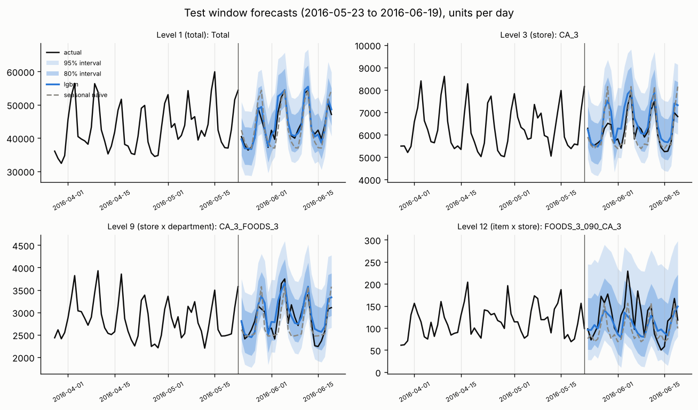
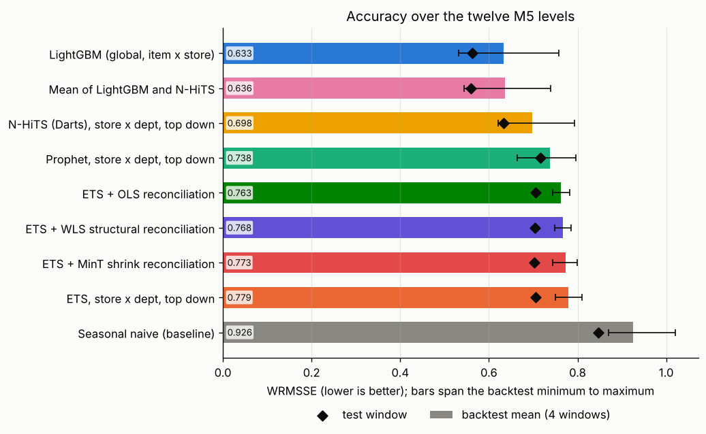
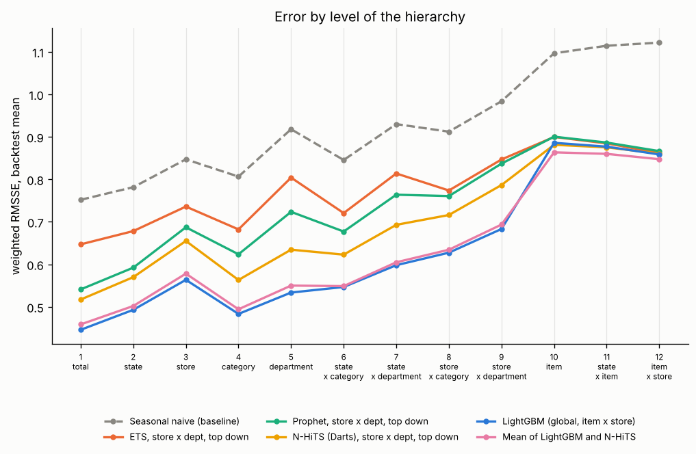

# Project 5: Retail demand forecasting

Forecast daily unit sales 28 days ahead for every item in every store of the M5 Walmart data, with prediction intervals for stock planning.



## Headline result

**A global LightGBM model on all 30,490 item x store series scores a WRMSSE of 0.562 on the official M5 evaluation window, against 0.847 for the seasonal naive baseline** (34 percent lower). It was chosen on four earlier backtest windows, where it also ranked first (0.633 against 0.926). Its forecast of total daily sales is off by 2.5 percent on average (MAPE).

| Model | Backtest WRMSSE, mean (min to max) | Test WRMSSE | Test MAPE, total | Test MAPE, store x department |
| --- | ---: | ---: | ---: | ---: |
| **LightGBM, global, item x store (selected)** | **0.633** (0.531 to 0.758) | **0.562** | 2.5% | 13.6% |
| Mean of LightGBM and N-HiTS | 0.636 (0.544 to 0.739) | 0.560 | 2.7% | 14.4% |
| N-HiTS (Darts), store x department, top down | 0.698 (0.621 to 0.793) | 0.633 | 3.7% | 16.5% |
| Prophet, store x department, top down | 0.738 (0.663 to 0.796) | 0.717 | 4.8% | 15.0% |
| ETS + OLS reconciliation, top down | 0.763 (0.744 to 0.782) | 0.706 | 5.1% | 16.7% |
| ETS, store x department, top down | 0.779 (0.750 to 0.811) | 0.705 | 5.5% | 15.4% |
| Seasonal naive (baseline) | 0.926 (0.870 to 1.021) | 0.847 | 5.8% | 19.5% |

WRMSSE is the M5 measure: the root mean squared error of each series, scaled by its own day to day variation, weighted by its dollar sales and averaged over twelve levels from the national total down to item x store. Lower is better; an RMSSE of 1.0 equals the in sample error of a one day ahead forecast that repeats yesterday. The other two ETS reconciliation methods and the per level scores are in [`reports/backtest_results.md`](reports/backtest_results.md).



### Which model to use and why

* **Use LightGBM for the item x store forecasts.** It has the lowest WRMSSE of the single models in all four backtest windows and in the test window, and the lowest error at every level from the total down to store x department in three of the four backtest windows. In the first window (the 28 days after d_1829) Prophet and reconciled ETS do better at some aggregate levels. LightGBM is the only model here that learns from prices, SNAP days and events per item. It costs 10 to 13 minutes of training per forecast on 4 CPU cores.
* **The ensemble is not worth its cost here.** Averaging LightGBM with N-HiTS lowers the error slightly at the three item levels (10 to 12) but raises it at the upper levels; overall it is level with LightGBM (0.636 against 0.633 on the backtest, 0.560 against 0.562 on the test window) and needs a second model.
* **At the item level all models are close.** At levels 10 to 12, every model except the baseline lands between 0.85 and 0.90 on the backtest ([figure](reports/figures/wrmsse_by_level.png)). Most of the gain of LightGBM over the other models comes from the aggregate levels: totals by state, store, category and department.
* **ETS and Prophet remain useful as quick checks** on aggregate series: they need under a minute for the 154 series of levels 1 to 9 and need no feature engineering.



### Prediction intervals for stock planning

Intervals are split conformal: the quantiles of each model's scaled errors on the backtest windows are added to its point forecast. At the item x store level, the 95 percent intervals of LightGBM hold 94.1 percent of the test days and the 80 percent intervals 77.5 percent. At store x department level the figures are 94.9 and 81.3 percent. The native intervals of the statistical models are less reliable: ETS intervals are too wide (91.6 percent coverage at a nominal 80) and N-HiTS intervals too narrow (74.5 percent at 80). Full table: [`backtest_results.md`](reports/backtest_results.md#prediction-intervals), [figure](reports/figures/interval_coverage.png).

A stock planner can take the upper bound of the 95 percent interval as the demand to cover for a 97.5 percent service level per day (one sided).

### Hierarchical reconciliation

ETS was fitted on all 154 series of levels 1 to 9 (total, 3 states, 10 stores, 3 categories, 7 departments and their crossings) and reconciled four ways so that the forecasts add up. On the backtest windows:

| ETS forecasts, levels 1 to 9 | Mean weighted RMSSE, backtest | Test |
| --- | ---: | ---: |
| OLS reconciliation | **0.723** | 0.618 |
| Base forecasts (do not add up) | 0.728 | 0.616 |
| WLS structural reconciliation | 0.729 | 0.616 |
| MinT shrink reconciliation | 0.737 | 0.614 |
| Bottom up from store x department | 0.745 | 0.618 |

OLS and WLS reconciliation make the forecasts add up at no loss of accuracy; MinT loses 0.009 on the backtest. Every method beats summing the store x department forecasts (bottom up) at the total level. The differences between the methods are small (0.014 on the backtest) and their order changes on the test window, so no method is clearly better on this data.

## Dataset and license

[M5 Forecasting: Accuracy](https://www.kaggle.com/competitions/m5-forecasting-accuracy) (University of Nicosia, hosted on Kaggle, 2020). Daily unit sales of 3,049 products in 10 Walmart stores in California, Texas and Wisconsin, from 29 January 2011 to 19 June 2016 (1,969 days), with weekly shelf prices, the calendar of events and SNAP (food stamp) days. The products fall into 3 categories and 7 departments, which gives 42,840 series over the twelve aggregation levels.

**License: no license or terms of use are stated** on the University of Nicosia M5 page or on the copy used here. The R package `m5`, which downloads the data, states the MIT license for its own code only. The Kaggle competition rules govern the Kaggle copy, which does not resolve from the build environment. This repository therefore claims no license for the data and does not redistribute it.

`make data` downloads the archive that Nixtla publishes on GitHub (`raw.githubusercontent.com/Nixtla/m5-forecasts`, 50 MB zip, eight CSV files including the truth of the final evaluation window and the official weights) and checks its SHA256 checksum, the 30,490 series, the 1,969 days, the hierarchy, the prices and the weights. A local zip with the same files can be used instead: `python -m retail_forecast.data --source <file>`.

**Check of the scoring code:** on the official evaluation window, the weights computed here match the official weights file to within 2e-10, and the seasonal naive and naive forecasts score 0.847 and 1.752, the values published for these benchmarks in the M5 results.

## Approach

1. **Load and check** (`data.py`): the archive is pinned by checksum; every table is checked before use. Sales and prices are stored as wide matrices (series x days).
2. **Windows** (`config.py`): four backtest windows of 28 days, after d_1829, d_1857, d_1885 and d_1913, and the official test window after d_1941. Every model sees only the days up to its origin. The model is chosen on the backtest windows; the test window is scored once.
3. **Closures:** all stores close on Christmas Day. The statistical and neural models see the mean of the same weekday one week before and after instead of the zero. This was found while checking the pipeline on the test window, before any model was compared; with the zeros in place, ETS reconciled with MinT scored worse than without reconciliation.
4. **Baseline** (`statistical.py`): seasonal naive, the last observed week repeated.
5. **ETS** (`statistical.py`): additive error, damped trend and weekly season on log units, fitted with statsmodels to the last three years of each of the 154 series of levels 1 to 9.
6. **Prophet** (`statistical.py`): weekly and yearly seasonality and the calendar events as holidays, on log units, for the 70 store x department series.
7. **N-HiTS** (`neural.py`): one global Darts model for the 70 store x department series, trained with quantile loss on log units scaled per series (112 day input, 28 day output, 40 epochs on CPU).
8. **LightGBM** (`gbm.py`): one global model for all item x store series, trained on the last 546 days with a Tweedie objective. Features: sales lags of 28 to 56 days, rolling means and spread ending 28 days back, price level and changes, days on sale, calendar, events, SNAP days and the item, department, category, store and state. No feature reads the 28 days before the forecast day, so one model forecasts the whole window without feeding forecasts back. A test checks that changing those days changes nothing. The 56 and 112 day rolling means carry 74 percent of the gain ([figure](reports/figures/lgbm_importance.png)).
9. **Top down split** (`hierarchy.py`): models of the store x department series are split to items by each item's share of the last 28 days, so every model is scored the same way on all twelve levels.
10. **Reconciliation** (`reconcile.py`): bottom up, OLS, WLS structural and MinT with shrinkage (Wickramasuriya, Athanasopoulos and Hyndman 2019; Schäfer and Strimmer 2005), applied to the ETS forecasts of levels 1 to 9.
11. **Evaluation** (`metrics.py`, `evaluate.py`): WRMSSE over the twelve levels with weights and scales computed from the history up to each origin, as in the M5 guide; MAPE on days with positive sales at levels 1, 3 and 9; interval coverage and width.
12. **Tracking:** every model's scores are logged to a local MLflow store under `artifacts/` (`mlflow ui --backend-store-uri sqlite:///artifacts/mlflow.db`).

Planned but left out: Databricks (needs an account; the data fits in memory on one machine) and sktime (statsmodels covers ETS).

## Demand tables for project 12

`make data` also writes the daily demand of every series of levels 1 to 9 as long tables (`data/demand/level_<n>.parquet`). Project 12 (inventory control) fits its demand distributions to them:

```python
from retail_forecast.demand import daily_demand

store_dept = daily_demand(9)   # columns: level, series, store_id, dept_id, d, date, units
items = daily_demand(12)       # item x store, built on request, with sell_price
```

## Reproduce

From this folder, with Python 3.11 or later:

```bash
make install            # this project, the shared common package and Darts with PyTorch (about 1 GB)
make all                # data, train (all models, 5 windows), evaluate, report: 85 minutes on 4 CPU cores
make smoke              # the same pipeline on a synthetic archive, no download
```

Without the neural extra (`pip install -e ../../common -e ".[dev]"`), the pipeline skips N-HiTS and runs every other model. Run times per window on 4 CPU cores: LightGBM 11 minutes, N-HiTS 4 minutes, Prophet and ETS under a minute each ([`reports/timings.json`](reports/timings.json)). The LightGBM step needs about 7 GB of memory. `make smoke` writes everything under `artifacts/smoke/`; its numbers come from synthetic data and say nothing about Walmart.

## Layout

```
src/retail_forecast/   config, data, demand, hierarchy, metrics, statistical, gbm, neural,
                       reconcile, backtest, evaluate, report, synthetic
tests/                 unit tests (data checks, hierarchy, metrics, models, leakage) and an end to end test
reports/               results tables, results.json, figures
```

## Cost

No paid service used: 0 CAD.
