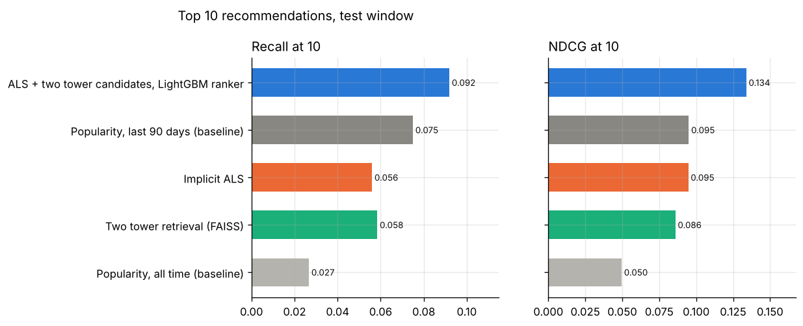
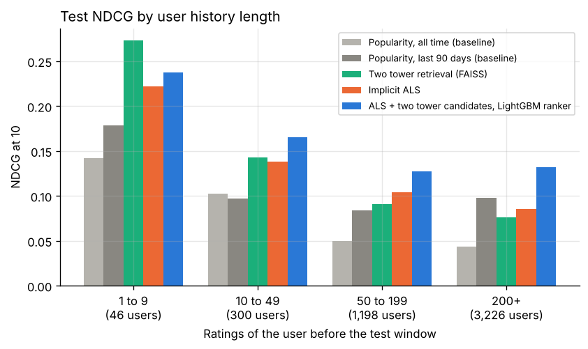

# Project 7: Movie recommendations

Recommend ten movies per user from the rating history of MovieLens 32M, and compare candidate generation and ranking approaches on a time based split.



## Headline result

**A two stage system (ALS and two tower candidates, reordered by a LightGBM LambdaRank model) reaches an NDCG at 10 of 0.134 on the test window (February to October 2023), against 0.095 for the best baseline**, the most rated movies of the last 90 days. Paired by user, the gain is +0.039 (95% interval 0.034 to 0.044). It was selected on the validation window, where it also ranked first (0.149 against 0.106).

| Model (test window, 4,770 users) | Recall at 10 | NDCG at 10 | Hit rate at 10 | Coverage at 10 | Novelty at 10 |
| --- | ---: | ---: | ---: | ---: | ---: |
| **ALS + two tower candidates, LightGBM ranker (selected)** | **0.092** ± 0.005 | **0.134** ± 0.005 | 0.488 | 1.9% | 4.9 |
| Popularity, last 90 days (baseline) | 0.075 ± 0.005 | 0.095 ± 0.004 | 0.413 | 0.2% | 4.8 |
| Implicit ALS | 0.056 ± 0.004 | 0.095 ± 0.005 | 0.370 | 2.9% | 4.0 |
| Two tower retrieval (FAISS) | 0.058 ± 0.004 | 0.086 ± 0.004 | 0.369 | 3.4% | 5.3 |
| Popularity, all time (baseline) | 0.027 ± 0.003 | 0.050 ± 0.004 | 0.217 | 0.4% | 1.6 |

± is the half width of a 95 percent interval over users. Recall at 10 is the share of the movies a user rated 4 or more in the window that the top 10 contains; NDCG at 10 also rewards placing them high; hit rate is the share of users with at least one such movie in the top 10. Coverage is the share of the catalog (80,647 movies) that appears in any top 10 list; novelty is the mean of minus log2 of the share of users who had rated a recommended movie (higher means less known movies). Full tables, the validation window and the paired differences: [`reports/results.md`](reports/results.md).

### What the comparison shows

* **Recency matters more than taste for a single list.** The most rated movies of the last 90 days score as well as ALS on NDCG (0.095 against 0.095, paired difference 0.000 ± 0.006) and better on recall. In a time based split, users rate what is new; a model fitted on 25 years of ratings does not know what is in season.
* **The ranking model combines both.** Its top features are the 90 day popularity of a movie (17 percent of the gain), how long the movie has been in the catalog and its mean rating, then the ALS and two tower scores and the genre affinity of the user ([figure](reports/figures/ranker_importance.png)). It beats every other model for users with 10 or more ratings before the window.
* **Retrieval sets the ceiling.** The union of the ALS and two tower top 100 (170 movies per user) holds at least one liked movie for 80 percent of the validation users; the ranking model only reorders it.
* **Learned models recommend a wider catalog.** ALS and the two tower model cover 3 percent of the catalog in their top 10 lists, the 90 day popularity list 0.2 percent; the ranking model sits between them (1.9 percent) at a higher accuracy ([figure](reports/figures/coverage_novelty.png)).

### Cold start



* **Users with few ratings:** the two tower model is best for users with 1 to 9 ratings before the window (NDCG 0.273, 46 users, so the interval is wide); the ranking model is best from 10 ratings on. The two tower user vector is a mean over the last 50 movies and their genres, so it needs fewer ratings than an ALS factor.
* **New users** (no rating before the window, 2,701 users with a liked movie): only a popularity list is possible. The 90 day list reaches NDCG 0.273, because new users start by rating well known recent movies.
* **New movies:** 2.5 percent of the liked ratings in the test window are on 1,368 movies with no earlier rating, which ALS cannot score at all. Ranked among these movies only, by their genres, decade and tags with an unknown id, the two tower model reaches recall at 10 of 0.074 against 0.006 for a random order (1,941 users).

### Choices made on the validation window

* **ALS:** 128 factors, regularization 0.5, 15 iterations (four settings compared; 256 factors overfit).
* **Two tower:** 6 epochs, the last of the six tried; validation recall still rose at epoch 6 (0.054 at epoch 3, 0.058 at epoch 6), so more epochs may help.
* **Ranker:** trained on one half of the validation users and compared on the other half; refitted on all validation users for the test window.

## Dataset and license

[MovieLens 32M](https://grouplens.org/datasets/movielens/32m/) (GroupLens Research, University of Minnesota, released May 2024): 32,000,204 ratings (0.5 to 5 stars) and 2,000,072 tags from 200,948 users on 87,585 movies, January 1995 to October 2023. Cite: F. Maxwell Harper and Joseph A. Konstan, 2015, The MovieLens Datasets: History and Context, ACM Transactions on Interactive Intelligent Systems 5(4).

**License:** the GroupLens usage license allows research use, requires the citation above, and forbids redistribution without separate permission and any commercial use without permission. This repository does not include the data.

`make data` downloads the zip from GroupLens, or reads a local copy (`SOURCE=<zip>`), and checks the published MD5 (`d472be332d4daa821edc399621853b57`) and the release counts. In this build environment the GroupLens host was blocked; the zip was uploaded by hand and matched the MD5.

## Approach

1. **Data** (`data.py`): ratings, movies and tags read from the zip and checked (half star ratings, one rating per user and movie, every rated movie listed). Release year from the title, one column per genre.
2. **Time based split** (`interactions.py`): the last 2 percent of ratings by time form the test window (20 February to 13 October 2023), the 2 percent before them the validation window (7 June 2022 to 20 February 2023). Each stage fits on all ratings before its window.
3. **Target:** the movies a user rates 4 or more in the window. Scored users have at least one such movie and at least one earlier rating. No model recommends a movie the user has already rated.
4. **Baselines** (`baselines.py`): the most rated movies over the whole history and over its last 90 days.
5. **Implicit ALS** (`als.py`, Hu, Koren and Volinsky 2008): every rating counts as a view; BM25 weighting; the `implicit` package.
6. **Two tower retrieval** (`two_tower.py`, PyTorch): the movie tower embeds the id, genres, release decade and the ten most used tags (tags written before the cutoff only); the user tower embeds the last 50 rated movies and their mean genre profile. Training examples are movies a user rated 4 or more, with the movies rated before them as the history (20 per user per epoch, 3.6 million). Loss: softmax over the other movies of the batch of 2,048, with the log sampling frequency subtracted (Yi et al. 2019). One id in ten is hidden during training, so that features alone can place a movie. Retrieval is exact inner product search in a FAISS flat index.
7. **Ranking** (`ranker.py`, `rank.py`): LightGBM LambdaRank on the union of the ALS and two tower top 100, with 16 features: both retrieval scores and ranks, popularity overall and over 90 days, mean rating, days in the catalog and release year of the movie, activity, mean rating and idle days of the user, genre affinity and the gap between the movie's and the user's mean rating. Every feature uses only the history before the cutoff.
8. **Evaluation** (`metrics.py`, `evaluate.py`): recall, NDCG and hit rate at 10 with 95 percent intervals, catalog coverage, novelty, paired differences per user, and cold start by history length, for new users and for new movies.
9. **Tracking:** scores are logged to a local MLflow store under `artifacts/` (`mlflow ui --backend-store-uri sqlite:///artifacts/mlflow.db`).

Planned but left out: LightFM (its build fails on Python 3.13); the two tower model with movie features covers the same hybrid of content and collaborative signals.

## Demo

```bash
make demo        # Streamlit page on http://localhost:8501
```

Pick a test user to see the last movies rated before the window, the movies liked in the window, and the top 10 of every model side by side, liked movies marked. Example lists for three users chosen at random: [`reports/demo_lists.md`](reports/demo_lists.md); none of their top 10 movies was rated in the window, which is the case for about half of the users (hit rate 0.49).

## Reproduce

From this folder, with Python 3.11 or later:

```bash
make install                         # this project, the demo extra and the shared common package
make all SOURCE=path/to/ml-32m.zip   # or without SOURCE to download from GroupLens: about 45 minutes on 4 CPU cores
make smoke                           # the same pipeline on a synthetic archive, no download
```

`make sample SAMPLE=0.05` runs the same pipeline on a seeded share of the real users with all their ratings; the time split is computed on the sample. Its data and outputs stay under `artifacts/sample/`, and `sample.json` there records the share, the seed and the counts. The option was added after the full run and was first run on Colab on 2026-10-26; those outputs are not committed, and the committed results come from the full data. The data step takes the same option as `--sample` and `--sample-seed`.

Run times on 4 CPU cores: data 40 seconds; per stage, ALS 75 seconds per setting, the two tower model 15 minutes for 6 epochs, the ranker under a minute ([`reports/results.md`](reports/results.md#run-times-seconds)). `make train` stores every finished step under `artifacts/` and skips it when run again, and the two tower model saves each epoch, so a stopped run resumes. `make smoke` writes everything under `artifacts/smoke/`; its numbers come from synthetic data and say nothing about MovieLens.

## Layout

```
src/movie_recs/   config, data, interactions, metrics, baselines, als, two_tower, ranker,
                  train, rank, evaluate, report, demo, synthetic
demo/app.py       Streamlit demo page
tests/            unit tests (data checks, split, metrics, models, leakage, resume) and an end to end test
reports/          results.md, results.json, demo_lists.md, figures
```

## Cost

No paid service used: 0 CAD.
