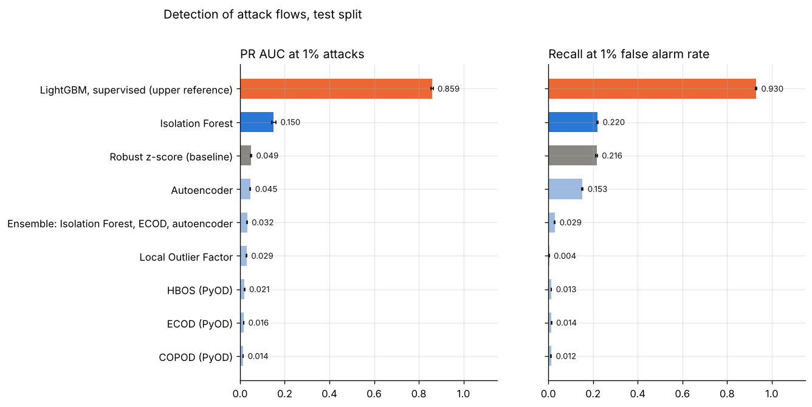
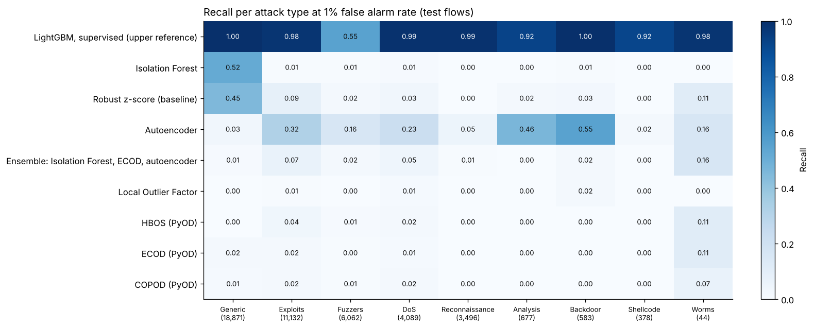

# Project 8: Network intrusion as anomaly detection

Flag unusual network flows in UNSW-NB15 without labels for known attacks, then measure how well each detector finds the attacks, per attack type, at a fixed false alarm rate.



## Headline result

**Without labels, Isolation Forest finds 22 percent of the attack flows in the UNSW-NB15 test file at a 1 percent false alarm rate (95% interval 21.6 to 22.3 percent), and almost all of them are of one type (Generic).** A supervised LightGBM model, which needs labeled attacks, finds 93 percent. Rescaled to a network where 1 in 100 flows is an attack, the PR AUC is 0.150 for Isolation Forest and 0.859 for LightGBM. Isolation Forest was selected on validation PR AUC; the robust z-score baseline scores almost as high on validation (0.106 against 0.110).

| Detector (test file, 82,332 flows) | PR AUC at 1% attacks | ROC AUC | Recall at 1% FPR | Test FPR | Precision of top 1,000 alerts |
| --- | ---: | ---: | ---: | ---: | ---: |
| LightGBM, supervised (upper reference) | 0.859 | 0.984 | 0.930 | 6.9% | 1.000 |
| **Isolation Forest (selected)** | **0.150** | 0.815 | **0.220** | 1.4% | 1.000 |
| Robust z-score (baseline) | 0.049 | 0.785 | 0.216 | 1.9% | 0.864 |
| Autoencoder | 0.045 | 0.829 | 0.153 | 2.9% | 0.905 |
| Ensemble: Isolation Forest, ECOD, autoencoder | 0.032 | 0.818 | 0.029 | 1.5% | 0.719 |
| Local Outlier Factor | 0.029 | 0.785 | 0.004 | 0.6% | 0.640 |
| HBOS (PyOD) | 0.021 | 0.745 | 0.013 | 2.6% | 0.344 |
| ECOD (PyOD) | 0.016 | 0.639 | 0.014 | 0.9% | 0.674 |
| COPOD (PyOD) | 0.014 | 0.597 | 0.012 | 1.0% | 0.612 |

The threshold of each detector flags 1 percent of the normal validation flows. The test file holds 55 percent attacks, far more than a monitored network, so the observed PR AUC (0.844 for Isolation Forest) mostly measures that share; the table rescales it to 1 percent attacks from recall and false alarm rate, which do not depend on the share. Intervals for every number, the observed PR AUC and the label free threshold: [`reports/results.md`](reports/results.md).

### What the comparison shows



* **Detectors miss different attacks.** Isolation Forest catches 52 percent of Generic attacks (repeated DNS flows between the same hosts and ports) and almost nothing else. The autoencoder catches 55 percent of Backdoor, 46 percent of Analysis and 32 percent of Exploits flows, and 3 percent of Generic. No unsupervised detector finds more than 6 percent of Reconnaissance or Shellcode flows. The ensemble averages the scores and so dilutes both strengths: at this threshold it is worse than Isolation Forest and the autoencoder, and better only than its third member, ECOD.
* **Most attacks look like normal flows one at a time.** All detectors except Isolation Forest stay under 0.05 PR AUC at 1 percent attacks. The density and distribution based detectors (LOF, HBOS, ECOD, COPOD) find 0.4 to 1.4 percent of attacks, close to the 1 percent that a random alarm would find.
* **A few attacks in the training data hurt the autoencoder most** ([figure](reports/figures/contamination.png), three seeds per share). Trained on normal flows only, it reaches ROC AUC 0.925 and recall 0.44 (range over seeds 0.43 to 0.45). With 1 percent attacks in the training sample, recall drops to 0.13, with 5 percent to 0.08: the network learns to reconstruct the attacks it sees, many of which are exact repeats. Isolation Forest changes less (ROC AUC 0.81 to 0.82 up to 5 percent attacks), but its recall at 1 percent FPR falls from 0.22 with 1 percent attacks to 0.03 with 5 percent; with no attacks at all it is 0.16, so its recall does not simply rise as the sample gets cleaner. A training window known to be clean is worth more than a better detector.
* **The time to live features do not carry the unsupervised detectors.** Without `sttl`, `dttl` and `ct_state_ttl`, Isolation Forest and the supervised model score the same (PR AUC at 1 percent attacks 0.157 and 0.854), and the autoencoder slightly better ([figure](reports/figures/ttl_ablation.png)).
* **The test file differs from the training file.** Thresholds set on validation flows (drawn from the training file) flag 1.4 percent of normal test flows for Isolation Forest, 2.9 percent for the autoencoder and 6.9 percent for LightGBM, against the 1 percent intended. A threshold needs checking on recent traffic before use.
* **A threshold without any labels works for the best detectors.** Flagging the top 1 percent of training sample scores gives Isolation Forest a test false alarm rate of 0.9 percent and recall 0.21, close to the threshold set with labels.

### Alert triage

The 10,462 test alerts of Isolation Forest fall into 31 groups of the same protocol, service and state with the same three most unusual features. The largest group (6,554 alerts) is UDP DNS flows with a median of 26 flows to the same destination among the last 100 flows, against 3 in the training sample; all are Generic attacks. Two of the top five groups are normal traffic (ARP flows with long gaps between packets, TCP flows with slow handshakes), which an analyst would close as known behavior. The 15 top groups with their features: [`reports/triage_example.md`](reports/triage_example.md).

## Dataset and license

[UNSW-NB15](https://research.unsw.edu.au/projects/unsw-nb15-dataset) (Cyber Range Lab of UNSW Canberra, 2015): network flows from a test bed that mixes normal traffic with nine attack types (Fuzzers, Analysis, Backdoor, DoS, Exploits, Generic, Reconnaissance, Shellcode, Worms). Each flow has 49 columns: addresses and ports, protocol, service and state, sizes, packet counts, timing, TCP features, connection counts over recent flows, the attack type and a 0/1 label.

Cite: N. Moustafa and J. Slay, 2015, UNSW-NB15: a comprehensive data set for network intrusion detection systems, Military Communications and Information Systems Conference (MilCIS).

**License:** to my knowledge the dataset page allows free use for academic research and asks for the citation above, and it does not grant redistribution. The page could not be opened from the build environment, so these terms were not checked again there. This repository does not include the data.

The release is a shared folder without stable direct file links, so `make data` reads the files from `data/raw/` (or `SOURCE=<folder>`):

* **official partition** (used for the results): `UNSW_NB15_training-set.csv` (175,341 flows) and `UNSW_NB15_testing-set.csv` (82,332 flows) from the folder "Training and Testing Sets". Both counts match the documented ones. The test file holds 37,000 normal flows and 45,332 attacks;
* **full records** (also read; tested on synthetic files only): `UNSW-NB15_1.csv` to `UNSW-NB15_4.csv` and `NUSW-NB15_features.csv` from the folder "CSV Files", about 2.5 million flows. They could not be moved into the build environment (the transfer of 100 MB to 170 MB files timed out), so the smaller partition was used.

`make data` also accepts a zip of these files. When both layouts are present it reads the official partition, as for the committed results; `--layout full` selects the full records. It stops when the counts differ from the documented ones; `--no-count-check` goes on and records the difference in `data/audit.json`. The full records hold 2,540,047 rows against 2,540,044 documented, so they need that option. The audit (`reports/results.md`) counts 103,576 flows that repeat another flow exactly and 7,745 test flows that also occur in the training file; repeats are common in Generic attacks. They are kept, as in the published partition.

## Approach

1. **Data** (`data.py`): the files are read and checked (49 columns, labels 0 or 1, one spelling per attack type, cells that are not numbers counted and set to 0). Counts are compared with the documented ones and recorded in `data/audit.json`.
2. **Split:** the official partition keeps its test file and splits its training file 80 / 20 into train and validation, stratified by attack type. The full records would be split 60 / 20 / 20.
3. **Features** (`features.py`): 36 numeric flow features (signed log, then standard scaling) and one hot columns for the 12 most frequent protocol, service and state values. Addresses, ports, times and TCP sequence numbers are left out: they identify test bed hosts and sessions, not the behavior of a flow.
4. **Training sample without labels:** the unsupervised detectors are fitted on training flows with 1 percent attacks, as a log from a network that is attacked now and then: all 44,800 normal training flows and 453 attacks drawn at random (up to 200,000 flows with the full records). The label is used only to build this sample and to score the results.
5. **Detectors** (`detectors.py`): a robust z-score baseline (mean distance from the median in interquartile ranges), Isolation Forest (300 trees of 512 flows), Local Outlier Factor (35 neighbors, fitted on 20,000 flows), HBOS, ECOD and COPOD from PyOD, a dense autoencoder in PyTorch (`autoencoder.py`: 64, 32, 8 units, up to 150 epochs with early stopping on a held out tenth of the training sample; it stopped at epoch 149 and kept epoch 144, [figure](reports/figures/autoencoder_training.png)), and an ensemble of Isolation Forest, ECOD and the autoencoder (mean of score quantiles). A supervised LightGBM model trained on all labeled training flows is the upper reference.
6. **Threshold and metrics** (`metrics.py`, `evaluate.py`): each detector's threshold flags 1 percent of the normal validation flows. On the test flows: PR AUC (observed, and rescaled to 1 percent attacks), ROC AUC, recall, false alarm rate and precision at that threshold, precision of the top 100 and 1,000 alerts, recall per attack type, and 95 percent bootstrap intervals (200 resamples). A second threshold uses no labels at all: the top 1 percent of training sample scores. The detector is selected on validation PR AUC rescaled to 1 percent attacks.
7. **Contamination study:** Isolation Forest and the autoencoder are refitted on samples with 0, 1, 5 and 20 percent attacks, each with three seeds.
8. **Ablation:** four detectors without the time to live features (`sttl`, `dttl`, `ct_state_ttl`), which can separate test bed networks rather than behavior.
9. **Triage example** (`report.py`): the top 20 test alerts of the selected detector, each with the three features that deviate most from the training sample.
10. **Tracking:** scores are logged to a local MLflow store under `artifacts/` (`mlflow ui --backend-store-uri sqlite:///artifacts/mlflow.db`).

## Reproduce

From this folder, with Python 3.11 or later:

```bash
make install                      # this project and the shared common package
make all SOURCE=path/to/csv/files # or a zip, or place the files in data/raw/: about 5 minutes on 4 CPU cores
make smoke                        # the same pipeline on synthetic flows, no data needed
```

`make sample SAMPLE=0.1` runs the same pipeline on a seeded share of the real flows, stratified by attack type and split. Its data and outputs stay under `artifacts/sample/`, and `sample.json` there records the share, the seed and the counts. The option was added after the full run and was first run on Colab on 2026-10-26; those outputs are not committed, and the committed results come from the full data. The data step takes the same option as `--sample` and `--sample-seed`.

`make train` stores every finished detector under `artifacts/` and skips it when run again, and the autoencoder saves each epoch, so a stopped run resumes. `make smoke` writes everything under `artifacts/smoke/`; its numbers come from synthetic data and say nothing about UNSW-NB15.

## Layout

```
src/flow_anomaly/  config, data, features, detectors, autoencoder, metrics,
                   train, evaluate, report, synthetic
tests/             unit tests (data checks, split, metrics, detectors, resume) and an end to end test
reports/           results.md, results.json, triage_example.md, figures
```

## Cost

No paid service used: 0 CAD.
