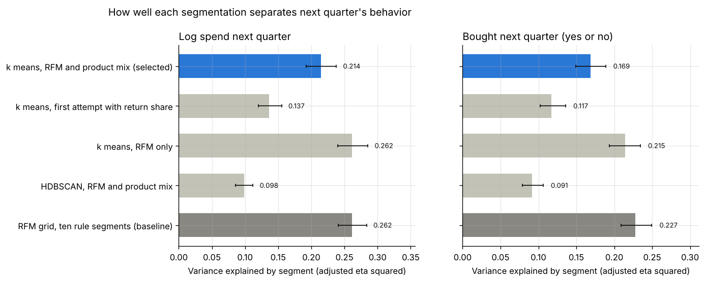
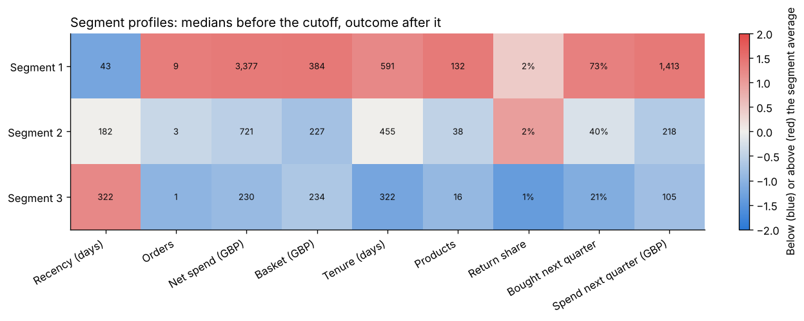

# Project 9: Customer segments of an online retailer

Group the customers of a UK online gift retailer into segments that marketing can act on, describe each segment, and check on the following quarter whether the segments separate what customers do next.



## Headline result

**k means on RFM and product mix features finds three stable segments (bootstrap adjusted Rand index 0.95): active repeat buyers (29 percent of customers, 82 percent of net spend), occasional repeat buyers (41 percent, 14 percent) and single order customers (30 percent, 4 percent).** On the quarter after the cutoff, which no clustering saw, the segments explain 21.4 percent of the variance of log spend (95% interval 19.2 to 23.8 percent). The ten rule segments of the classic RFM grid explain more, 26.2 percent, and so does k means on recency, frequency and monetary value alone (26.2 percent): the product mix adds no structure that helps.

| Segmentation (5,240 customers) | Segments | Log spend next quarter | Bought next quarter | Purchase rate, lowest to highest segment |
| --- | ---: | ---: | ---: | ---: |
| RFM grid, ten rule segments (baseline) | 10 | 0.262 (0.241 to 0.284) | 0.227 (0.209 to 0.250) | 16% to 82% |
| k means, RFM only | 3 | 0.262 (0.240 to 0.285) | 0.215 (0.194 to 0.235) | 17% to 78% |
| **k means, RFM and product mix (selected)** | **3** | **0.214** (0.192 to 0.238) | **0.169** (0.149 to 0.189) | 21% to 73% |
| k means, first attempt with return share | 4 | 0.137 (0.120 to 0.155) | 0.117 (0.102 to 0.136) | 20% to 62% |
| HDBSCAN, RFM and product mix | 3 | 0.098 (0.086 to 0.112) | 0.091 (0.079 to 0.106) | 21% to 54% |

Numbers are adjusted eta squared: the share of the variance of the outcome that the segment means explain, adjusted for the number of segments, with 95 percent bootstrap intervals over customers. Full tables: [`reports/results.md`](reports/results.md).

### The three segments



| Segment | Customers | Net spend before the cutoff | Median orders | Median days since last order | Median basket | Bought next quarter | Share of next quarter's spend |
| --- | ---: | ---: | ---: | ---: | ---: | ---: | ---: |
| 1 Active repeat buyers | 1,508 (29%) | 82% | 9 | 43 | 384 GBP | 73% | 77% |
| 2 Occasional repeat buyers | 2,169 (41%) | 14% | 3 | 182 | 227 GBP | 40% | 17% |
| 3 Single order customers | 1,563 (30%) | 4% | 1 | 322 | 234 GBP | 21% | 6% |

What each segment calls for, with the RFM grid groups inside it: [`reports/segment_playbook.md`](reports/segment_playbook.md). An interactive map of all customers (UMAP, hover for each customer's values, without customer ids): [`reports/segment_map.html`](reports/segment_map.html), to download and open in a browser.

### What the comparison shows

* **Recency and frequency carry the segments.** Segment 3 is exactly the customers with one order, and segments 1 and 2 split the repeat buyers by number of orders, recency and spend. The UMAP map shows the single order customers as a separate island ([figure](reports/figures/umap_segments.png)).
* **The product mix does not separate customers.** The mean category shares of the three segments differ by at most 3.4 percentage points (kitchen and dining 21.7 to 22.5 percent, bags 6.7 to 10.1 percent, home decor 13.3 to 16.2 percent; [figure](reports/figures/product_mix.png)). k means on the category shares alone reaches a silhouette of 0.07 to 0.11 for every k from 2 to 6. Most customers are gift shops that buy across the whole range.
* **Simple rules match or beat the clustering on what happens next.** The RFM grid uses two quintile scores and ten named rules, and it explains the next quarter at least as well as any clustering here. A clustering is worth its cost when it finds structure that the rules miss; on this data it does not.
* **The number of segments is clear, the boundaries less so.** The gap statistic picks k = 3 for the selected scaling, in agreement with the selection rule, and the bootstrap refits reproduce the three segments (Jaccard overlap 0.96 to 1.00 per segment). From k = 4 on, the silhouette falls under 0.15 and the stability to 0.85 or lower ([figure](reports/figures/k_selection.png)).
* **Density based methods find no dense groups.** HDBSCAN marks every customer as noise with standard or robust scaling; with quantile scaling it finds two groups and marks 0.6 percent of the customers as noise. DBSCAN results depend strongly on the radius (one to six groups, 2 to 29 percent noise).
* **Scaling decides what k means finds.** Without a log transform, k means isolates a handful of very large wholesale customers (smallest segment under 1 percent of customers). The quantile scaling turns every value that many customers share, such as one order or a return share of zero, into a gap, and k means splits along those gaps.

### The first attempt and the choice made after it

The first run used a seventh behavior feature, the share of purchase value returned. With quantile scaling, the selection rule chose k = 4, and the four segments were exactly two yes or no facts: one order or more, and any return or none. Most customers never return anything, and the quantile scaling turned that zero into a gap. This first attempt explains the next quarter least of all k means solutions (0.137).

After that result, the user chose (decision S97 in the project thread) to drop the return share from the clustering features and to repeat the selection; the return share stays in the profiles. The second run showed a gap in the selection rule: the unscaled features had the highest mean stability, but only with segments under 1 percent of the customers, so no candidate. The rule now compares only scalings with at least one candidate. Both changes were made after seeing results; the first attempt stays in the tables so that its effect is visible. Its profiles: [`reports/results.md`](reports/results.md#segment-profiles-of-the-first-attempt-with-return-share).

## Dataset and license

[Online Retail II](https://archive.ics.uci.edu/dataset/502/online+retail+ii) (UCI Machine Learning Repository, dataset 502, by Daqing Chen): all transactions of a UK based online retailer of gifts between 1 December 2009 and 9 December 2011, one row per order line: invoice, stock code, description, quantity, invoice date, unit price in pounds sterling, customer id and country. Many customers are wholesalers.

**License:** CC BY 4.0, as stated on the UCI page when this project was planned. The UCI host could not be reached from the build environment, so the terms were not checked again there; the file was supplied by the user from the UCI page. This repository does not include the data. The interactive map holds rounded values of each customer without the customer id, which CC BY 4.0 allows with this attribution.

Cite: D. Chen, Online Retail II, UCI Machine Learning Repository (see the UCI page for the current citation).

`make data` reads `online_retail_II.xlsx` (both yearly sheets), a CSV export of both sheets, or a zip that holds either. The file has 1,067,371 rows, as documented. Cleaning, counted in `data/audit.json`:

* 34,335 exact duplicate rows dropped, 22,202 of them because the two yearly sheets overlap in December 2010;
* 235,151 rows without a customer id dropped (2.6 million GBP, 13 percent of the value read);
* invoices that start with "C" kept as returns (18,390 lines); 70 other lines with a quantity or price of 0 or less dropped;
* 3,652 lines with a stock code that is not a product (postage, manual adjustments, fees, discounts) kept out of the spend features;
* 797,815 lines of 5,939 customers kept.

## Approach

1. **Product categories** (`categories.py`): the release has no category column. Keyword rules on the description, first match wins, give twelve categories (Christmas, lights and candles, bags, kitchen and dining, stationery and wrap, toys and crafts, party, storage, garden, jewellery and accessories, home decor, other). 7.1 percent of the purchase value matches no rule.
2. **Cutoff** (`features.py`): the last 91 days (10 September to 9 December 2011, the Christmas season) are held out. Features describe each customer up to the cutoff; 5,240 customers have a positive net spend before it.
3. **Features:** recency, number of orders, net spend, mean basket, tenure and number of distinct products, log transformed where skewed, and the share of purchase value per category. The category block is weighted so that its total variance is half that of the behavior block.
4. **Scaling choices:** none (standard scaling of the untransformed values), standard, robust (median and interquartile range) and quantile (to a normal distribution).
5. **k means** (`clustering.py`): k from 2 to 10 for each scaling and for three feature sets (RFM only, RFM and product mix, the first attempt with return share), with silhouette, Calinski Harabasz and Davies Bouldin scores, the gap statistic (20 uniform reference sets), and bootstrap stability: 50 refits on resampled customers, each compared with the full fit by adjusted Rand index, and per segment by the Jaccard overlap of its best match.
6. **Selection without the outcome** (`evaluate.py`): a solution is a candidate when its mean stability is at least 0.80 and its smallest segment holds at least 2 percent of the customers, with k from 3 to 8. Silhouettes of different scalings are not compared; among scalings with a candidate, the one with the highest mean stability is chosen (quantile), and within it the candidate with the highest silhouette (k = 3).
7. **DBSCAN and HDBSCAN** on the same features: DBSCAN with the radius at four quantiles of the distance to the 10th neighbor, HDBSCAN with minimum cluster sizes of 25, 50 and 100.
8. **Baseline:** the RFM grid, recency and frequency scores from 1 to 5 mapped to ten named segments (champions, loyal, potential loyalists, new customers, promising, need attention, about to sleep, cannot lose, at risk, hibernating).
9. **Check on the next quarter:** adjusted eta squared of log spend and of the purchase indicator, with 200 bootstrap resamples.
10. **Profiles and map** (`report.py`): medians, product mix, return share and next quarter values per segment; UMAP (30 neighbors) of the clustering features for a static figure and the interactive map (Plotly).
11. **Tracking:** the comparison is logged to a local MLflow store under `artifacts/` (`mlflow ui --backend-store-uri sqlite:///artifacts/mlflow.db`).

## Reproduce

From this folder, with Python 3.11 or later:

```bash
make install                                    # this project and the shared common package
make all SOURCE=path/to/online_retail_II.xlsx   # or the zip from UCI, or place it in data/raw/: about 15 minutes on 4 CPU cores
make smoke                                      # the same pipeline on synthetic order lines, no data needed
```

`make train` stores each stage under `artifacts/` and skips it when run again. `make smoke` writes everything under `artifacts/smoke/`; its numbers come from synthetic data and say nothing about Online Retail II.

## Layout

```
src/customer_segments/  config, data, categories, features, clustering,
                        train, evaluate, report, synthetic
tests/                  unit tests (cleaning, categories, features, clustering, selection) and an end to end test
reports/                results.md, results.json, segment_playbook.md, segment_map.html, figures
```

## Cost

No paid service used: 0 CAD.
