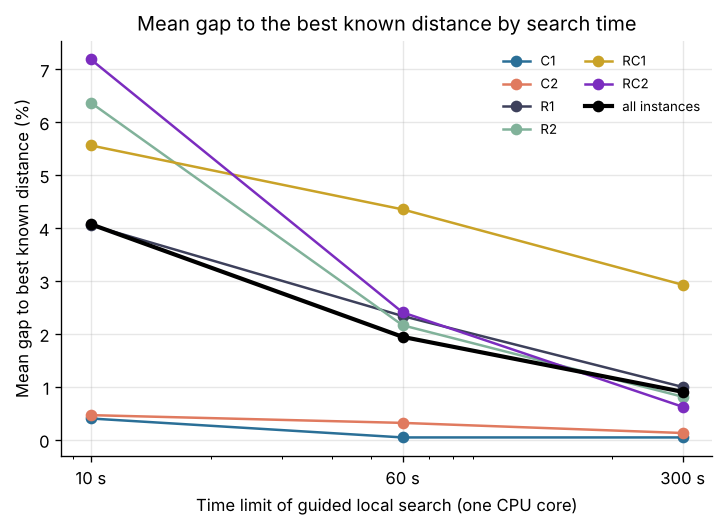
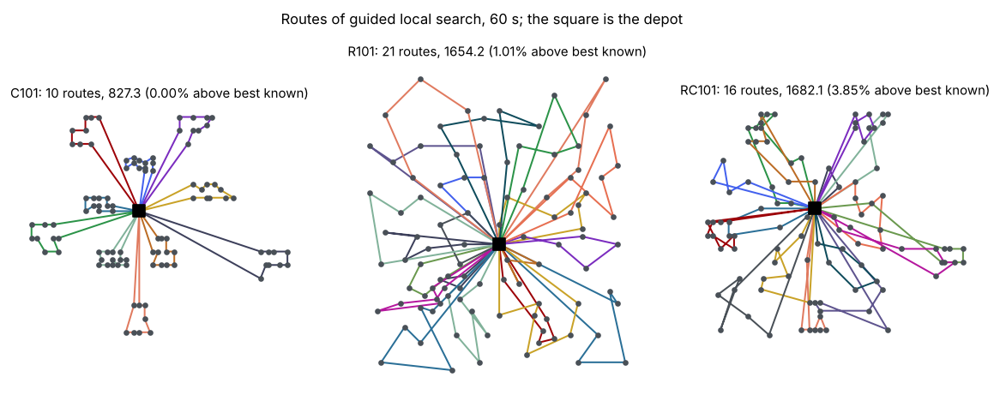
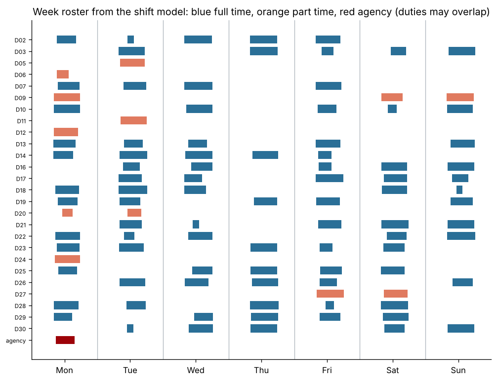
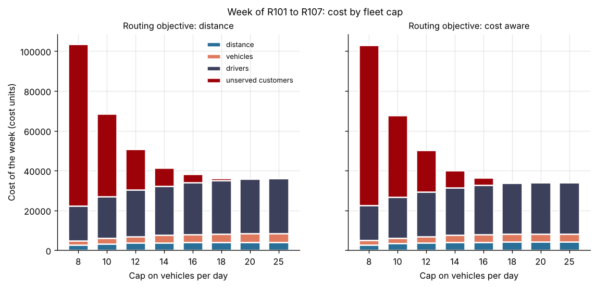

# Project 10: Delivery routes and driver shifts

Plan delivery routes with vehicle capacity and customer time windows, then build driver shifts that cover the routes at minimum cost, and measure how the fleet size changes the cost of a week.



## Headline result

**OR-Tools with guided local search comes within 0.9 percent of the best known distance on average over the 56 Solomon instances in 300 seconds per instance on one CPU core (18 instances at the best known value, largest gap 5.7 percent). The construction heuristics alone are 53 to 102 percent above it.** The shift model in Pyomo reaches optimality in about one second with HiGHS and CBC for two and four days; for the full week with 30 drivers both stop at the 300 second limit, HiGHS 0.9 percent below the greedy baseline and CBC level with it. Routing for the cost of the whole operation instead of distance alone lowers the cost of the week by 5.6 percent.

| Routing configuration (56 instances) | Solved | Mean gap | Median gap | Largest gap | Within 1% | Seconds |
| --- | ---: | ---: | ---: | ---: | ---: | ---: |
| Cheapest arc, first solution (baseline) | 49 | 101.6% | 82.6% | 250.0% | 0% | 7.51 |
| Cheapest insertion, first solution (baseline) | 56 | 52.9% | 54.5% | 94.3% | 0% | 0.02 |
| Guided local search, 10 s | 56 | 4.1% | 3.9% | 16.8% | 27% | 10 |
| **Guided local search, 60 s (main)** | **56** | **1.9%** | **2.0%** | **6.1%** | **38%** | **60** |
| Guided local search, 300 s | 56 | 0.9% | 0.5% | 5.7% | 61% | 300 |

Gap: distance above the best known solution, in the DIMACS convention of the best known values (distances truncated to one decimal, distance as the only objective). The cheapest arc heuristic finds no feasible first solution on seven instances with tight windows (R101, R102, R103, R105, R106, RC101, RC105). Per class, per instance and all other tables: [`reports/results.md`](reports/results.md).



Interactive maps of these three plans, with each customer's window and service time on hover: [`reports/maps/`](reports/maps) (download and open in a browser).

### What the comparison shows

* **Clustered instances are easy, tight random ones are not.** In 300 seconds the search reaches the best known distance on 15 of the 17 clustered instances (C1, C2). On the RC1 class, random and clustered customers with short windows, the mean gap stays at 2.9 percent and falls slowly with more time ([figure](reports/figures/gap_by_class.png)).
* **Most of the gain comes in the first minute.** The mean gap falls from 4.1 percent at 10 seconds to 1.9 percent at 60 seconds and 0.9 percent at 300 seconds. On the R2 and RC2 classes, few long routes, the search keeps improving the longest.
* **The construction heuristic matters for feasibility.** With tight windows the cheapest arc heuristic gets stuck; the parallel cheapest insertion heuristic always finds a plan, and the local search starts from it.

### Driver shifts

The 105 routes of the main configuration on R101 to R107 form a week of duties (one instance per day, the depot hours mapped onto 08:00 to 18:00, 15 minutes of vehicle check before and after each route). The synthetic pool has 30 drivers: 18 full time (32 CU per hour, 30 hours a week guaranteed, at most 48 hours and 5 days) and 12 part time (36 CU per hour, at most 30 hours and 4 days), each with days off and a daily window. A shift is paid from its first to its last duty, at least 4 hours, with overtime above 40 hours a week at 1.5 times the wage; a duty that no driver can take goes to an agency at 60 CU per hour.

| Scenario | Duties | Binaries | HiGHS | CBC | Gurobi | Greedy baseline |
| --- | ---: | ---: | --- | --- | --- | ---: |
| 2 days, 8 drivers | 39 | 171 | 16,726.9, optimal in 0.11 s | 16,726.9, optimal in 0.10 s | 16,726.9, optimal in 0.03 s | 17,046.6 |
| 4 days, 18 drivers | 63 | 698 | 20,796.8, optimal in 1.16 s | 20,796.8, optimal in 0.49 s | over the license size limit | 21,105.9 |
| 7 days, 30 drivers | 105 | 2,095 | 27,685.5, 1.5% from bound at 300 s | 27,933.3, 2.3% from bound at 300 s | over the license size limit | 27,924.5 |

Cost in cost units (CU) for the scenario, including the weekly guarantees. One thread per solver.



* **The model is small when the formulation is tight.** A first version with a big M of one day in the shift start and end constraints did not prove optimality for four days of a trial week in 120 seconds with CBC. Big M terms bounded by each driver's window and one valid inequality (a shift is paid at least the total length of its duties) brought that to 0.5 seconds.
* **The full week stays hard.** Both open solvers stop at the limit with a gap of 1.5 to 2.3 percent to the lower bound; the greedy roster is within 0.9 percent of the best roster found. Most of the cost is fixed: the guarantees of the full time drivers are 17,280 CU of about 27,700.
* **Gurobi** ran through its pip package, whose license is limited to 2,000 variables and 2,000 constraints for non production use. Only the two day scenario fits; there it agrees with HiGHS and CBC. A larger comparison needs an academic or commercial license.

### Fleet size



The week was planned again with a cap of 8 to 25 vehicles per day (30 seconds of search per day), each customer left unserved at 500 CU, and staffed with the shift model (HiGHS, 300 seconds, gaps to the lower bound of 2.0 percent or less). The routing objective is either distance or a cost aware objective: distance at 0.45 CU per km, 40 CU per vehicle day plus its two vehicle checks, and driver time per minute of route.

| Plan | Km | Vehicle days | Unserved | Duty hours | Drivers | Total cost |
| --- | ---: | ---: | ---: | ---: | ---: | ---: |
| Main benchmark plan (distance, 60 s, 25 vehicles) | 9,104 | 105 | 0 | 823.5 | 27,685 | 35,982 |
| Distance objective, cap 20 | 9,144 | 105 | 0 | 819.9 | 27,656 | 35,971 |
| **Cost aware objective, cap 20** | **9,338** | **101** | **0** | **777.1** | **25,741** | **33,984** |
| Cost aware objective, cap 16 | 9,103 | 96 | 7 | 760.0 | 24,895 | 36,331 |

* **The distance objective is not the cost objective.** The cost aware plan drives 2.6 percent more km but needs 4 fewer vehicle days and 46 fewer duty hours, which lowers the week's cost by 5.6 percent. The MIP gaps of these two runs (1.5 and 0.3 percent) are smaller than that difference.
* **Below 20 vehicles a day, customers stay unserved.** With a cap of 18 the distance plan leaves 2 customers unserved and the cost aware plan 1; at 8 vehicles, 161 to 162 of 700. Above 20 vehicles nothing changes: the plans use at most 21.

## Dataset and license

The [Solomon VRPTW benchmark](https://www.sintef.no/projectweb/top/vrptw/) (M. M. Solomon, 1987): 56 instances with 100 customers each in six classes (C clustered, R random, RC mixed; class 1 with short horizons and small vehicles, class 2 with long horizons and large vehicles). The files come from the [PyVRP instance collection](https://github.com/PyVRP/Instances) (MIT license), pinned to commit `7474b06`, in VRPLIB format with best known solutions taken from CVRPLIB. The SINTEF and CVRPLIB pages could not be reached from the build environment, so the best known values were not compared with those pages again. The instances are published benchmark data; this repository does not include them.

`make data` downloads the 112 files (about 0.6 MB) and checks each against its SHA256 in [`solomon_files.json`](src/delivery_planning/solomon_files.json). It then checks every best known solution: all 56 visit each customer once, keep capacity and windows, and their recomputed distance equals the stated cost to the tenth.

The driver pool, the cost rates and the clock times of the shift model are synthetic, set in [`config.py`](src/delivery_planning/config.py); they are assumptions of a scenario, not data.

Cite: M. M. Solomon (1987), Algorithms for the vehicle routing and scheduling problems with time window constraints, Operations Research 35(2), 254 to 265.

## Approach

1. **Data** (`data.py`): VRPLIB files read with `vrplib`; distances in tenths of a unit, truncated in integer arithmetic, so OR-Tools works on the same numbers as the best known solutions. Travel time equals distance.
2. **Routing** (`routing.py`): OR-Tools routing with a capacity and a time dimension. Two baselines stop at the first solution (cheapest arc, parallel cheapest insertion); the main runs improve the insertion solution with guided local search for 10, 60 and 300 seconds. Every plan is checked by an independent function before it is stored.
3. **Duties** (`shifts.py`): for each route, the latest departure that still returns at the earliest return time gives the shortest duty.
4. **Shift model** (`shifts.py`): a mixed integer model in Pyomo. Binary assignment of duties to drivers, one per duty start for overlapping duties (interval cliques), shift start and end per driver and day with big M terms bounded by the driver's window, paid hours at least the span and at least four hours, weekly hours, days, guarantee and overtime per driver, and agency cover for open duties.
5. **Greedy baseline:** duties in start order, each to the driver with the lowest added cost that keeps every rule, else to the agency.
6. **Solver comparison** (`evaluate.py`): HiGHS (`highspy`), CBC (the `cbcbox` binary) and Gurobi (`gurobipy`, optional) through Pyomo, one thread, relative gap 0.0001, 300 seconds. Every roster is checked against the rules and priced independently of the model.
7. **Fleet size study:** the week with a cap on vehicles per day and both routing objectives, each staffed with the shift model.
8. **Tracking:** routing summaries, solver runs and fleet runs are logged to a local MLflow store under `artifacts/` (`mlflow ui --backend-store-uri sqlite:///artifacts/mlflow.db`).

OR-Tools ships its own build of HiGHS, and with both libraries loaded in one Python process `highspy` fails on a missing symbol. The routing searches therefore run in their own processes, and the planner solves its shift model with CBC.

## Planner

`make planner` starts a Streamlit page: choose an instance, an objective, the number of vehicles and the search time; it shows the routes on an interactive map with the gap to the best known solution, and staffs the day from the synthetic pool with the shift model.

## Reproduce

From this folder, with Python 3.11 or later:

```bash
make install   # this project, the shared common package and the optional Gurobi package
make all       # download, about 100 minutes of routing searches on 4 cores, 40 minutes of MIPs, report
make smoke     # the same pipeline on 12 small synthetic instances, about 2 minutes
```

`make sample SAMPLE=0.25` runs the same pipeline on a seeded share of the real instances, stratified by class; the seven instances of the shift week are always kept. Its data and outputs stay under `artifacts/sample/`, and `sample.json` there records the share, the seed and the counts. The option was added after the full run and was first run on Colab on 2026-10-26; those outputs are not committed, and the committed results come from the full data. The data step takes the same option as `--sample` and `--sample-seed`.

`make train` and `make evaluate` store each search and each MIP under `artifacts/` and skip it when run again. Guided local search stops at a time limit, so a repeated run on another machine can give slightly different routes and costs. `make smoke` writes under `artifacts/smoke/`; its numbers say nothing about the benchmark.

## Layout

```
src/delivery_planning/  config, data, routing, shifts, train, evaluate, report, synthetic
planner/app.py          Streamlit planner
tests/                  unit tests (distances, checks, routing, shift rules, MIP), end to end test, planner test
reports/                results.md, results.json, figures, maps
```

## Cost

No paid service used: 0 CAD. Gurobi ran under the size limited license of its pip package.
