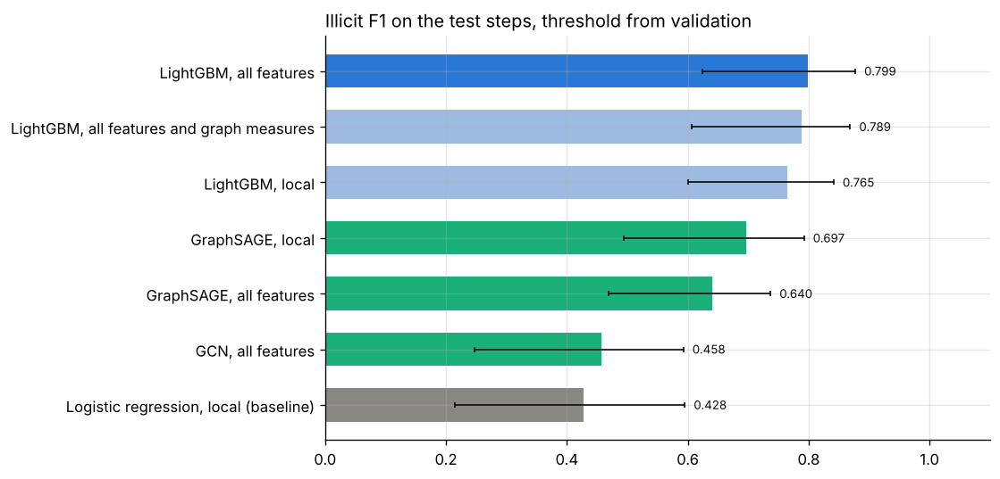
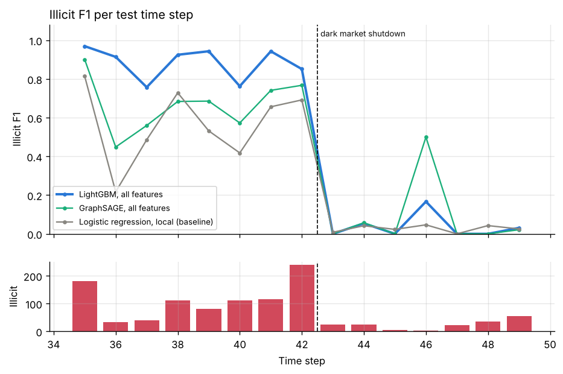
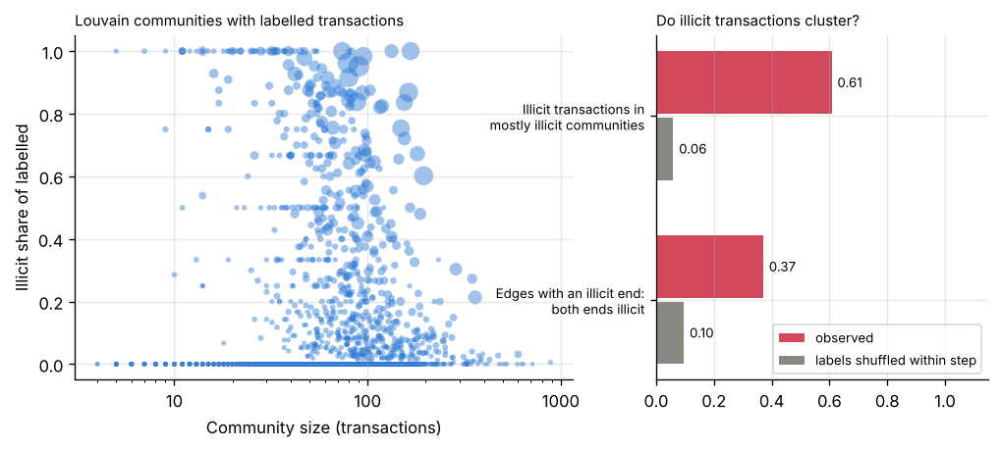

# Project 11: Illicit transactions in a payment network

Find illicit Bitcoin transactions and the clusters around them in the Elliptic transaction graph: describe the network with statistics, centrality and communities, then classify transactions with graph neural networks (GCN, GraphSAGE) and compare them with LightGBM models that see only the transaction features, on a split by time.



## Headline result

**On the Elliptic test steps (35 to 49), LightGBM on the transaction features reaches an illicit F1 of 0.799 (95% interval 0.624 to 0.877; precision 0.897, recall 0.721). No graph neural network beats it: GraphSAGE reaches 0.640 and GCN 0.458.** The logistic regression baseline reaches 0.428. Adding graph measures (degree, PageRank, betweenness and others) to LightGBM changes F1 by -0.011 (interval -0.027 to 0.002). LightGBM on all features was selected on validation F1 before the test steps were scored.

| Model (16,670 labelled test transactions, 1,083 illicit) | Test F1 (95% interval) | Precision | Recall | PR AUC | F1 steps 35 to 42 | F1 steps 43 to 49 |
| --- | ---: | ---: | ---: | ---: | ---: | ---: |
| **LightGBM, all features (selected)** | **0.799** (0.624 to 0.877) | 0.897 | 0.721 | 0.799 | 0.895 | 0.028 |
| LightGBM, all features and graph measures | 0.789 (0.606 to 0.869) | 0.859 | 0.729 | 0.799 | 0.891 | 0.034 |
| LightGBM, local features | 0.765 (0.600 to 0.841) | 0.876 | 0.679 | 0.778 | 0.857 | 0.019 |
| GraphSAGE, local features | 0.697 (0.493 to 0.792) | 0.899 | 0.569 | 0.712 | 0.785 | 0.020 |
| GraphSAGE, all features | 0.640 (0.470 to 0.737) | 0.677 | 0.607 | 0.630 | 0.726 | 0.024 |
| GCN, all features | 0.458 (0.247 to 0.593) | 0.795 | 0.321 | 0.555 | 0.522 | 0.000 |
| Logistic regression, local features (baseline) | 0.428 (0.215 to 0.595) | 0.303 | 0.726 | 0.217 | 0.593 | 0.021 |

Thresholds give the best F1 on the validation steps (31 to 34). Intervals come from resampling the 15 test steps. The graph networks average three seeds; single seeds reach 0.610 to 0.638 (GraphSAGE, all features), 0.683 to 0.691 (GraphSAGE, local) and 0.380 to 0.488 (GCN). All numbers, F1 at a threshold of 0.5 and paired differences with intervals: [`reports/results.md`](reports/results.md).

### What the comparison shows



* **Every model fails after the dark market shutdown.** Up to step 42, LightGBM finds 63 to 97 percent of the illicit transactions of each step with precision of 0.86 or more. From step 43 on, F1 is 0.03 or less for every model: the illicit transactions of those steps no longer look like the ones in training. A model like this needs monitoring of its flag rate and retraining on recent labels; better features or a graph model do not fix it.
* **The aggregated features already carry the neighborhood.** The 72 aggregated features describe the one hop neighbors of each transaction. With them, LightGBM gains 0.035 F1 over the local features alone (interval 0.024 to 0.045). GraphSAGE on the local features alone (0.697) does better than GraphSAGE on all features (0.640), so for the networks the aggregated features add more noise than signal. To my knowledge the published benchmark found the same order (random forest above GCN).
* **Message passing helps the linear view, not the tree model.** GraphSAGE on local features beats logistic regression on the same features by a wide margin (0.697 against 0.428), so neighbors carry information. LightGBM gets that information from the aggregated features and from nonlinear splits on the local ones.
* **GCN is the weakest graph model.** A likely reason, not tested here: GCN averages a transaction with its neighbors, which blurs the few illicit transactions in mostly licit neighborhoods, while GraphSAGE keeps the transaction's own features apart from the neighbor mean.
* **Validation is easier than test.** Validation F1 is 0.98 for LightGBM against 0.80 on test before any shift: the four validation steps hold more illicit transactions (17 percent of labels against 6.5 percent) and are closer in time to the training steps.

### The network



* **Each time step is one connected graph** of 1,089 to 7,880 transactions with a density of about 0.0003 and negative degree assortativity (-0.08 on average): many transactions with one or two edges hang on a few hubs. Louvain finds 29 to 113 communities per step with modularity 0.82 to 0.94.
* **Illicit transactions cluster.** Of the edges with an illicit end and a labelled other end, 37 percent join two illicit transactions, against 10 percent with labels shuffled within the step. 61 percent of illicit transactions sit in communities whose labelled members are mostly illicit, against 6 percent with shuffled labels.
* **Centrality alone does not find them** ([figure](reports/figures/centrality.png)). As the only score, every measure has a ROC AUC between 0.38 and 0.51. Illicit transactions have slightly fewer edges and less betweenness than licit ones. Component size is the size of the time step here (one component per step), so its value of 0.38 reflects in which steps illicit labels are frequent, not structure.
* **Subgraphs** ([figure](reports/figures/subgraphs.png)): the two hop neighborhoods of four illicit test transactions show two forms: an unlabelled hub joined to dozens of illicit transactions (steps 35 and 42), and a licit hub joined to many illicit and unlabelled ones (step 38). In step 48, after the shutdown, the selected model flags none of the 23 illicit transactions in the neighborhood.

## Dataset and license

[Elliptic Data Set](https://www.kaggle.com/datasets/ellipticco/elliptic-data-set) (Elliptic, 2019): a graph of Bitcoin transactions, where a node is a transaction and a directed edge a flow of bitcoins from one transaction to the next. `make data` counts the following in the files; all counts match the dataset description:

* 203,769 transactions in 49 time steps (about two weeks apart), and 234,355 edges. Edges join transactions of the same time step only, and each step forms one connected graph;
* 166 features per transaction: the time step, 93 local features (inputs and outputs, fees, volume and others; anonymized) and 72 features aggregated over the one hop neighborhood;
* labels: 4,545 illicit (2 percent), 42,019 licit (21 percent), the rest unlabelled. By split: training 2,954 illicit and 23,951 licit, validation 508 and 2,481, test 1,083 and 15,587.

Cite: M. Weber, G. Domeniconi, J. Chen, D. K. I. Weidele, C. Bellei, T. Robinson and C. E. Leiserson, 2019, Anti-Money Laundering in Bitcoin: Experimenting with Graph Convolutional Networks for Financial Forensics, KDD Workshop on Anomaly Detection in Finance.

**License:** to my knowledge the Kaggle page lists the data for research use and does not grant redistribution. The page could not be opened from the build environment, so these terms were not checked there. This repository does not include the data.

Kaggle downloads need a login, so `make data` reads the files from `data/raw/` (or `SOURCE=<folder>`): `elliptic_txs_features.csv`, `elliptic_txs_classes.csv` and `elliptic_txs_edgelist.csv`. `SOURCE` may also be the Kaggle zip as downloaded.

## Approach

1. **Data** (`data.py`): the three files are read and checked (167 columns, time steps 1 to 49, class values `1`, `2` or `unknown`, every edge between known transactions). Duplicate edges and self loops are counted and dropped; edges that join two time steps are counted. Counts are compared with the documented ones and recorded in `data/audit.json`.
2. **Split by time:** train on steps 1 to 30, validate on 31 to 34, test on 35 to 49. Steps 35 to 49 are the test period of the published benchmark. As no edge joins two steps, no message passes between the periods, and no model sees a later transaction during training.
3. **Network analysis** (`network.py`, NetworkX): per time step, density, weakly connected components, degree assortativity, clustering and Louvain communities with their modularity; per transaction, in and out degree, PageRank, betweenness (estimated from 256 source transactions per step), clustering coefficient, core number and component size. Each measure is compared between illicit and licit transactions, also as the only score (ROC AUC). Two checks test whether illicit transactions cluster: the share of edges with an illicit end whose other end is illicit too, and the share of illicit transactions in communities that are mostly illicit, each against labels shuffled within the time step.
4. **Models** (`train.py`), all trained on the labelled transactions of the training steps:
   * logistic regression on the local features (baseline);
   * LightGBM on the local features, and on the local and aggregated features (the feature only reference); early stopping on validation;
   * LightGBM on all features and the structural measures of step 3 (no labels are used for these);
   * GCN and GraphSAGE (`gnn.py`, PyTorch Geometric, two layers of 128 units, edges in both directions, class weights by inverse frequency, Adam with learning rate 0.005, early stopping on validation PR AUC after 40 epochs without gain, three seeds each, mean probability over seeds) on all features, and GraphSAGE on the local features only, to see whether message passing recovers what the aggregated features hold. Training uses the graph of the training steps, early stopping the graph of the validation steps. The best epochs were 96 to 259 of at most 400.
5. **Evaluation** (`evaluate.py`, `metrics.py`): the threshold with the best F1 on the validation steps, then test F1, precision and recall at that threshold, F1 per time step and before and from step 43. Intervals come from resampling the 15 test steps with replacement (200 times), because transactions of one step share their graph and period. Every model is also compared with the feature only LightGBM model as a paired difference over the same resampled steps. The model with the best validation F1 is selected.
6. **Subgraphs** (`report.py`): two hop neighborhoods around illicit test transactions, colored by label, with the transactions the selected model flags.
7. **Neo4j** (`neo4j_export.py`, `neo4j/`): an export of transactions (with class, model score, community, PageRank) and payments as CSV, a load script with `LOAD CSV` and six example Cypher queries: labelled transactions per step, unlabelled transactions next to two or more illicit ones, chains of illicit transactions, the highest scored unlabelled test transactions, communities with the most illicit transactions and the neighborhood of the most central illicit one. The scripts were written for Neo4j 5.26 and later; a Neo4j server could not be run in the build environment, so they are checked by tests for structure and column names, not yet run against a server.
8. **Tracking:** metrics are logged to a local MLflow store under `artifacts/` (`mlflow ui --backend-store-uri sqlite:///artifacts/mlflow.db`).

## Reproduce

From this folder, with Python 3.11 or later:

```bash
make install                      # this project and the shared common package
make all SOURCE=path/to/archive.zip  # or the CSV folder: about 35 minutes on 4 CPU cores
make smoke                        # the same pipeline on a synthetic graph, no data needed
```

`make sample SAMPLE=0.5` runs the same pipeline on a seeded share of the real time step graphs, stratified by split; steps 42 and 43 are always kept. Its data and outputs stay under `artifacts/sample/`, and `sample.json` there records the share, the seed and the counts. The option was added after the full run and was first run on Colab on 2026-10-26; those outputs are not committed, and the committed results come from the full data. The data step takes the same option as `--sample` and `--sample-seed`.

`make train` stores every finished model (and every seed of a graph network) under `artifacts/` and skips it when run again, so a stopped run resumes.

To load the graph into Neo4j (Docker, from this folder, after `make all`):

```bash
docker run -d --name p11-neo4j -p 7474:7474 -p 7687:7687 \
  -v "$PWD/artifacts/neo4j:/import" -e NEO4J_AUTH=neo4j/<password> neo4j:5.26
pip install -e ".[neo4j]"
NEO4J_PASSWORD=<password> make neo4j-load   # runs neo4j/load.cypher, then neo4j/queries.cypher
```

The answers of the queries are written to `artifacts/neo4j/answers.md`. The queries can also be pasted into the Neo4j Browser at `http://localhost:7474`.

## Layout

```
src/illicit_graph/  config, data, network, gnn, metrics, train, evaluate, report,
                    neo4j_export, synthetic
neo4j/              load.cypher, queries.cypher
tests/              unit tests (data checks, network measures, metrics, models, Cypher files) and an end to end test
reports/            results.md, results.json, figures
```

## Cost

No paid service used: 0 CAD.
