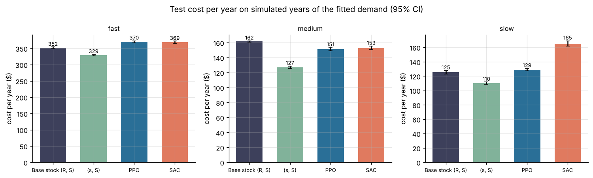
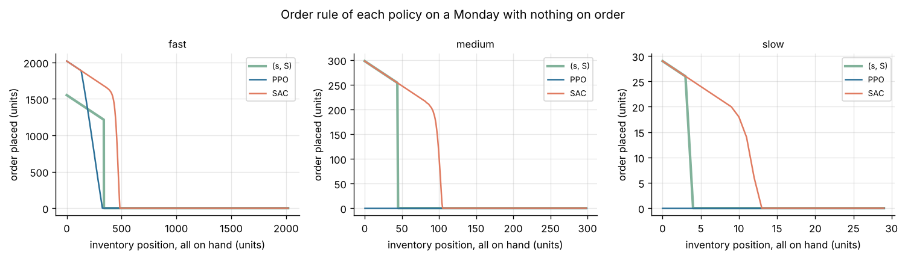
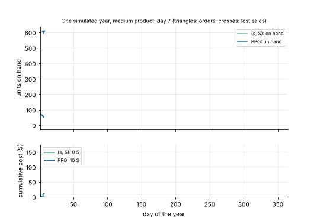

# Project 12: Inventory control with reinforcement learning

Learn a daily reorder policy for one product in one store, with random demand and random lead times, and compare it with the classic (s, S) and base stock policies. Demand comes from distributions fitted to three M5 products of project 5: a fast, a medium and a slow (intermittent) mover.



## Headline result

**The tuned (s, S) policy has the lowest cost for all three products. PPO and SAC, trained on the cost reward, cost 12 to 20 percent more on the fast and medium products; on the slow product PPO costs 17 percent more and SAC 50 percent more.** The periodic review base stock policy sits between (s, S) and the RL policies on the fast and medium products. On the slow product with a fixed lead time, where the exact optimum is known, (s, S) is 3.6 percent above it and PPO 24.7 percent. These results come from a sample run (`SAMPLE=0.2`, one seed per algorithm; see below), so the RL figures show what a short training budget reaches, not the limit of the method.

| Product (store CA_1) | (s, S) | Base stock (R, S) | PPO | SAC |
| --- | ---: | ---: | ---: | ---: |
| fast: FOODS_3_586, 48.1 units per day | **329** (327 to 332) | 352 (+6.7%) | 370 (+12.3%) | 369 (+12.1%) |
| medium: FOODS_3_348, 7.1 units per day | **127** (125 to 129) | 162 (+27.3%) | 151 (+19.3%) | 153 (+20.5%) |
| slow: HOBBIES_1_010, 0.67 units per day | **110** (109 to 112) | 125 (+13.8%) | 129 (+16.9%) | 165 (+50.1%) |

Mean cost per year in dollars over 100 simulated test years of the fitted demand, with 95 percent intervals; percentages are paired differences against (s, S) on the same years. Every policy keeps a fill rate of 97 percent or more except base stock on the slow product (90 percent). All tables, the fill rates, orders per year and mean stock: [`reports/results.md`](reports/results.md).

### What the comparison shows



* **The RL policies learned a weekly ordering cycle, not a reorder point.** In the first test year of the medium product, PPO places 13 of its 14 orders on a Friday and SAC all 13 on a Monday; (s, S) orders when the stock falls to 44 units, on whatever day that is. A weekly cycle is a cheaper form of the base stock policy (151 against 162 for the medium product), but it pays for stock it carries until the order day. With nothing on order and stock on hand, PPO orders nothing on a Monday at any position for the medium and slow products (figure above): it waits for its order day, while SAC, whose order day is Monday, orders up to a target there.
* **(s, S) is close to optimal here.** For the slow product with a 3 day lead time, backward induction over the 365 days gives the optimal policy: 103.1 $ per year in simulation, 102.5 expected. (s, S) is 3.6 percent above it, base stock 18.3 percent and PPO, trained on the same setting, 24.7 percent. The room for any learned policy to beat (s, S) is therefore a few percent at most in this setting; with random lead times (2 to 6 days) the gap is not known.
* **Training was short** ([learning curves](reports/figures/learning_curves.png)): the PPO curve of the medium product and the SAC curves of the fast and medium products still fall at the end of training; the slow product curves are noisy, as its validation uses 10 years of a product that sells on fewer than half the days. A trial run of PPO on the medium product of the full data reached 150 $ per year after 400,000 steps against 137 $ for its (s, S) policy, so a longer run narrows the gap but did not close it there.
* **Reward shaping did not help** ([figure](reports/figures/shaping.png)). On the medium product, PPO with the potential term cost 154.9 $ and with the extra penalty on lost units 156.3 $, against 151.4 $ with the plain cost reward. With one seed each, the spread over seeds is not measured, so the study shows no gain from shaping; it cannot show a loss either.
* **The order holds on the real test year** ([figure](reports/figures/replay_costs.png)). Replayed on the real units of d_1605 to d_1969 with random lead times, (s, S) costs 327, 126 and 90 $; PPO 372, 132 and 117 $; SAC 364, 130 and 147 $. The fitted model overstates the demand of the fast and slow products by about 13 percent (test year mean over model mean: 0.87), which helps every policy on the replay.
* **The demand model misses zero days of the medium product** ([figure](reports/figures/demand_fit.png)): 17 percent of its test year days have no sale, against 5 percent in the model. Part of these are likely days out of stock, which M5 does not mark.



The animation shows one simulated test year of the medium product: stock on hand, orders (triangles) and lost sales (crosses) of (s, S) and the best RL policy, with the cumulative cost below.

## Dataset and license

[M5 Forecasting: Accuracy](https://www.kaggle.com/competitions/m5-forecasting-accuracy) (University of Nicosia, hosted on Kaggle, 2020): daily unit sales and weekly prices of 3,049 products in 10 Walmart stores, 29 January 2011 to 19 June 2016. This project reads the same archive as [project 5](../p05_retail_forecasting) (the Nixtla copy on GitHub, 50 MB, pinned by its SHA256 checksum).

**License: no license or terms of use are stated** on the University of Nicosia M5 page or on the copy used here; the Kaggle competition rules govern the Kaggle copy. This repository therefore claims no license for the data and does not redistribute it. The figures show only aggregate demand of three series.

M5 holds sales, not demand: a day with zero sales can be a day out of stock. M5 holds no costs, stock levels or supplier data either, so the costs and lead times below are stated assumptions.

## The environment

`inventory_rl` registers a [Gymnasium](https://gymnasium.farama.org) environment, `inventory_rl/InventoryControl-v0`, and installs as a package (`pip install -e .`):

```python
import gymnasium as gym
import inventory_rl
from inventory_rl.data import load_products

env = gym.make("inventory_rl/InventoryControl-v0")  # a demo product
env = gym.make("inventory_rl/InventoryControl-v0", problem=inventory_rl.Problem.from_product(load_products()[0]))
```

* **One day:** the policy sees the state and orders; the order gets a lead time of 2 to 6 days (probabilities 0.1, 0.3, 0.3, 0.2, 0.1; mean 3.9), drawn at random and confirmed by the supplier, so the state shows the day each open order arrives; orders can cross. Then demand arrives, sales are the smaller of stock and demand, and the rest is lost. Orders due the next morning arrive.
* **Cost per day:** 10 $ for each order placed, holding cost of 25 percent per year of the unit cost on the units left at the end of the day, and the lost margin on each lost unit. Unit cost: 60 percent of the mean price (an assumed gross margin of 40 percent). The inventory position (on hand plus on order) cannot exceed a capacity of 42 days of mean demand (at least 20 units).
* **Observation:** on hand, units due on each of the next 6 days, inventory position (all scaled by the capacity) and the weekday. **Action:** one number in [-1, 1], read as a target position from 0 to the capacity; the order is the gap to the position, if positive. Every order size is reachable, and a base stock policy is a constant action.
* **Reward:** minus the day's cost over the order cost of 10 $. An episode is one year (365 days), ended by truncation.
* **Demand:** negative binomial per day with one mean per weekday and one dispersion, fitted by maximum likelihood on the 52 weeks before the test year (d_1241 to d_1604; Christmas closures left out).

The same dynamics run for a batch of episodes in `dynamics.py`, which tunes the baselines and scores every policy; a test checks that the environment and the batch simulator give the same cost. A scenario fixes the demand and lead time of every day in advance, so all policies are scored on the same random days.

## Approach

1. **Data** (`data.py`): the archive is pinned by checksum and checked; three item x store series are selected on the fit window only, by fixed rules: fast (under 2 percent zero days, mean near the 99th percentile), medium (under 20 percent zero days, mean near the 75th percentile), slow (50 to 70 percent zero days, median mean). The demand model is fitted per product and checked against the real test year (d_1605 to d_1969).
2. **Baselines** (`baselines.py`): periodic review base stock (order up to S every R days, R from 1 to 56 days) and (s, S) (order up to S when the position is at or below s), each tuned by grid search on simulated years of a seed stream of its own.
3. **Validation against the exact optimum** (`dp.py`): with one fixed lead time (3 days), the slow product has few enough states for backward induction over the 365 days, which gives the optimal policy. The simulator must reproduce the expected cost of that policy, and the gap of (s, S), base stock and PPO to it shows how much room there is.
4. **Reinforcement learning** (`train.py`): PPO (8 parallel environments, 512 steps each per update, two layers of 64 units) and SAC (two layers of 64 units) from Stable Baselines3, trained on the cost reward. Training starts each episode with a random stock up to half the capacity. Every 20,000 steps (scaled with the sample) the policy is scored on validation scenarios of a seed stream of its own; the best checkpoint is kept.
5. **Reward shaping study:** PPO on the medium product with two other rewards: a potential on the distance of the position to the middle of the tuned (s, S) band, which in theory leaves the best policy unchanged, and an extra penalty on lost units, which changes the objective. All policies are scored on the true cost.
6. **Evaluation** (`evaluate.py`): every policy on the same test scenarios (fitted demand, a seed stream never used before) and on a replay of the real test year with random lead times; mean yearly cost with 95 percent intervals, paired differences against (s, S), fill rate, orders per year and mean stock.
7. **Report** (`report.py`, `animate.py`): tables, figures and an animation of one simulated year.
8. **Tracking:** every training run and the evaluation are logged to a local MLflow store under `artifacts/` (`mlflow ui --backend-store-uri sqlite:///artifacts/mlflow.db`).

RLlib, listed as optional in the plan, is left out: it is a large install and adds no result that Stable Baselines3 does not give here.

## Run size and the sample option

`SAMPLE=<fraction>` runs every step on a sample: only store CA_1 is read and searched for the three products, and the training steps, seeds and scenario counts are scaled by the fraction (with lower bounds). Without it, the full run applies: all 10 stores, PPO for 1,000,000 steps and SAC for 200,000 steps, 5 seeds per algorithm and product, 500 test years.

The reported run used `SAMPLE=0.2` to keep the compute small for this proof of concept: products from store CA_1, PPO for 200,704 steps and SAC for 40,000 steps, one seed (42) per algorithm and product, one seed per shaping variant, 100 test years and 40 replay draws per product, 40 tuning years for the baselines and 10 validation years. Training took about 8 minutes on 4 CPU cores (about 100 s per PPO run, 390 s per SAC run). With one seed, the spread over seeds is not measured; the full run (5 seeds) gives it.

## Reproduce

From this folder, with Python 3.11 or later:

```bash
make install            # this project and the shared common package
make all SAMPLE=0.2     # the run reported here: about 15 minutes on 4 CPU cores; without SAMPLE about 4 hours
make smoke              # the same pipeline on a synthetic archive with tiny runs, no download
```

`make train` stores every finished run under `artifacts/runs/` and skips it when run again, so a stopped run resumes. `make validate` runs the dynamic program alone; it needs no training.

## Layout

```
src/inventory_rl/  config, data, demand, dynamics, env, baselines, dp, train, evaluate, report,
                   animate, synthetic
tests/             unit tests (dynamics, environment, demand fit, data checks, baselines, dynamic
                   program, run plan) and an end to end test
reports/           results.md, results.json, figures and the animation
```

## Cost

No paid service used: 0 CAD.
