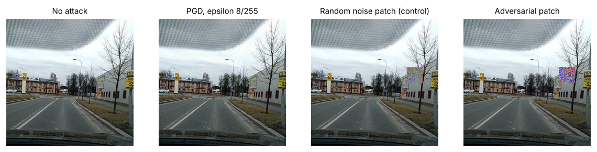
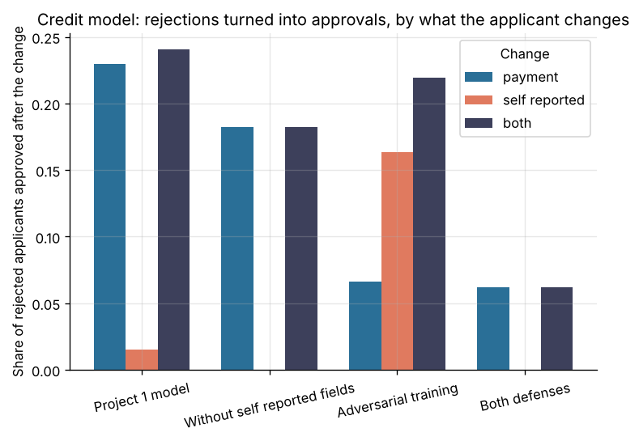

# Project 13: Adversarial robustness

Measure how easily the portfolio's own models can be manipulated, and what each defense costs in clean performance. Targets: the credit default model of project 1, the network flow detectors of project 8 and the road damage detector of project 6. Each target is rebuilt by the code of its own project, which is imported as a package,, on a seeded 0.2 sample of its data.



One Czech test image of RDD2022 (Arya et al., CC BY-SA 4.0), unchanged and under three attacks; this figure is shared under the same license. The PGD change is not visible, yet the detector finds no damage on the attacked test set.

## Headline result

**Every model fails under an attacker that stays inside realistic limits, and the cheapest defenses close most of the gap for the tabular models but not for the detector.**

| Target (sample 0.2) | Clean | Under attack | Best defense tried | Clean with defense | Under attack with defense |
| --- | ---: | ---: | --- | ---: | ---: |
| Credit model (project 1): rejected applicants who obtain approval | 0 | 24.1% | without self reported fields, plus adversarial training | ROC AUC 0.777 (0.770 before) | 6.2% |
| Flow detector, LightGBM (project 8): recall at 1% false alarms | 0.909 | 0.075 | adversarial training | 0.898 | 0.874 |
| Flow detector, Isolation Forest (project 8): Generic attacks found, 1% poisoned training traffic | 0.409 | 0.048 | drop the 5% highest scored training flows, refit | 0.491 | 0.493 (0 at 5% poison) |
| Road damage detector (project 6): test mAP50 | 0.504 | 0.121 (patch), 0.000 (PGD 2/255) | median filter 3x3 | 0.505 | 0.197 (patch), 0.003 (PGD) |

All tables: [`reports/results.md`](reports/results.md) and [`reports/results.json`](reports/results.json). Model card: [`MODEL_CARD.md`](MODEL_CARD.md).

### Findings and fixes



1. **Credit model: a borrowed payment buys approval.** With an extra payment of at most 10% of the credit limit in the latest month, 23.0% of rejected test applicants get approval; adding any education and marital status raises this to 24.1%. Most of them are applicants who repay (8.4% of the rejected defaulters turn), so the test profit under attack is not lower (7.17 against 6.95 million NT dollars). The risk is the defaulters who turn, and an attacker who learns the rule. **Fix:** do not use self reported fields that the bank does not verify, and train on manipulated copies of the training defaulters. Each defense alone moves the weakness: adversarial training alone lowers the payment attack from 23.0% to 6.6% but raises the self reported attack from 1.5% to 16.3%. Together they bring the rate to 6.2% (1.7% of rejected defaulters) at ROC AUC 0.777. In practice the latest month payment should also be checked against the source of funds, which no model change replaces.
2. **Flow detector: one header field defeats the supervised model.** LightGBM relies on the initial TTL of sent packets, a value the attacker's host sets. Setting it to a value common in normal traffic evades 90.8% of detected attack flows; padding, extra packets and delays alone evade 9.6%. Recall at 1% false alarms falls from 0.909 to 0.075. **Fix:** remove the TTL features (evasion 9.3%, clean recall 0.892), or train on feasible changes of the training attacks (evasion 2.7%, clean recall 0.898). The TTL dependence was already a suspicion in project 8 (its ablation); this attack confirms it.
3. **Without feasibility limits, every detected flow evades.** HopSkipJump (Adversarial Robustness Toolbox), free to move any feature, evades LightGBM on 200 of 200 flows with a median L2 change of 2.46 in the standardized feature space. The realistic limits above, not the model, are what keep 90% of flows detected after adversarial training.
4. **Isolation Forest is easy to poison.** Isolation Forest learns from unlabeled traffic. When 91 Generic attack flows (1% of the training sample) are slipped into that traffic, it finds 4.8% of the Generic test attacks instead of 40.9% ([figure](reports/figures/poisoning.png)). **Fix:** fit, drop the 5% highest scored training flows, refit: recall returns to 49.3% at 1% poison, but the defense fails at 5% poison and above (0%), when the poisoned flows are no longer rare. Removing exact duplicate flows does not help (9.1%). Evasion by size and timing changes also works against it (27.1% of detected flows).
5. **Randomized smoothing certifies too small a radius.** A LightGBM model trained with Gaussian noise and smoothed over 100 noisy copies certifies 76% of test flows correct within an L2 radius of 0.5 (sigma 0.5), and none within 1.0. The largest feasible size and timing change has a median L2 size of 1.42 in the same space, so the certificate does not cover the attack. Smoothing also costs precision: 38% false alarms at its own decision rule.
6. **Road damage detector: a faint pixel change removes all detections.** PGD at 2/255 (each pixel moves by at most 2 of 255 levels) brings test mAP50 from 0.504 to 0.000; FGSM at 2/255 to 0.013. A universal patch of 64 x 64 pixels (1.6% of the image), placed at random, brings it to 0.121, while a random noise patch at the same places leaves 0.500, so the effect is the pattern, not the occlusion ([figure](reports/figures/image_attacks.png)). **Fix, partial:** a 3x3 median filter costs nothing on clean images (0.505) and raises mAP50 under the patch to 0.197; JPEG and added noise do not help. Against the digital attacks no transformation restores more than 0.055. The attacks did not know the defense, so these defended numbers are an upper bound. A real fix needs adversarial training of the detector, which was not run (see below).

## Dataset and license

The data of the target projects, with their licenses:

* project 1: [Default of Credit Card Clients](https://archive.ics.uci.edu/dataset/350/default+of+credit+card+clients) (UCI, CC BY 4.0), 6,001 of 30,000 clients, stratified by default;
* project 8: [UNSW-NB15](https://research.unsw.edu.au/projects/unsw-nb15-dataset) official partition (UNSW Canberra; academic research use with citation: N. Moustafa and J. Slay, 2015, MilCIS), 51,546 of 257,673 flows, stratified by attack type and split;
* project 6: [RDD2022](https://github.com/sekilab/RoadDamageDetector) Czech images (CC BY-SA 4.0), 24 of 114 blocks of 25 consecutive images (579 images; 100 test images, 34 of them with 44 damage boxes), and the project 6 detector weights.

No data or weights are committed. The detector weights are those of the project 6 run "full" (YOLO11n, 12 epochs on a Colab T4 GPU, test mAP50 0.261 on Czech and India). The selected project 6 run (light augmentation, 0.288) was not kept. The clean mAP50 of 0.504 here comes from 44 boxes on 100 Czech images and is not comparable with the project 6 figures.

## Approach

* **Threat models** are stated per target in the module docstrings ([`credit.py`](src/adv_robustness/credit.py), [`flows.py`](src/adv_robustness/flows.py), [`images.py`](src/adv_robustness/images.py)). Tabular attacks are black box (only the decision or score of each try) and limited to what the attacker controls; image attacks are white box (the weights).
* **Credit:** a grid over extra payments (0 to 10% of the limit, 11 steps) and over the self reported fields; the project 1 feature SQL is recomputed for every candidate; the cheapest approved candidate wins. The project 1 model (LightGBM, isotonic calibration, profit threshold from out of fold predictions) is refitted for each defense.
* **Flows:** padding (bytes up to x3), extra packets (up to x2), delays (duration up to x5) with the derived features rescaled, a mean packet size cap of 1,500 bytes, and the three most common initial TTL values of normal traffic. Thresholds at 1% false alarms on normal validation flows, as in project 8. Poisoning adds training Generic flows to the unlabeled sample of Isolation Forest.
* **Images:** each attack raises the Ultralytics training loss on the true boxes; PGD uses 10 steps of epsilon/4 from a random start; the patch is trained for 60 steps of 8 training images with Adam. Every attacked image is saved as PNG and scored by the Ultralytics validator, as in project 6.
* **Not covered:** the plan also named prompt injection and data leakage tests on the question answering system of project 2. They are not part of this project. A public scanner such as [garak](https://github.com/NVIDIA/garak) can test that system; its results are not here. TextAttack and torchattacks, also named in the plan, were not needed: the image attacks act on the detection loss, which torchattacks (built for classifiers) does not support.

## Reproduce

From this folder, with Python 3.11 or later:

```bash
make install            # this project, common/ and projects 1, 6 and 8 as packages
make sample SAMPLE=0.2  # data, attacks, report: about 30 minutes on 4 CPU cores (images: 22 minutes)
make smoke              # the whole pipeline on synthetic sources and an untrained detector, about 5 minutes
```

Sources are read from `data/raw/credit` (the UCI zip), `data/raw/flows` (the two partition CSV files of project 8, or its four full record files, which are then used instead), `data/raw/images` (`RDD2022_Czech.zip`) and `data/raw/detector/best.pt`, or from `CREDIT_SOURCE`, `FLOWS_SOURCE`, `IMAGES_SOURCE` and `WEIGHTS`. `make all` runs on the full data; it has not been run. The committed results come from `make sample SAMPLE=0.2` (seed 42).

`make smoke` writes everything under `artifacts/smoke/`. Its numbers come from synthetic data and say nothing about any real model.

## Layout

```
src/adv_robustness/  config, data, credit, flows, images, report, synthetic
tests/               attack limits, feature recomputation, evasion search, image attacks, each part end to end
reports/             results.md, results.json, figures
```

## License of this folder

AGPL-3.0 (see [`LICENSE`](LICENSE)), like project 6: the image part uses Ultralytics YOLO, which is AGPL-3.0.

## Cost

No paid service used: 0 CAD.
